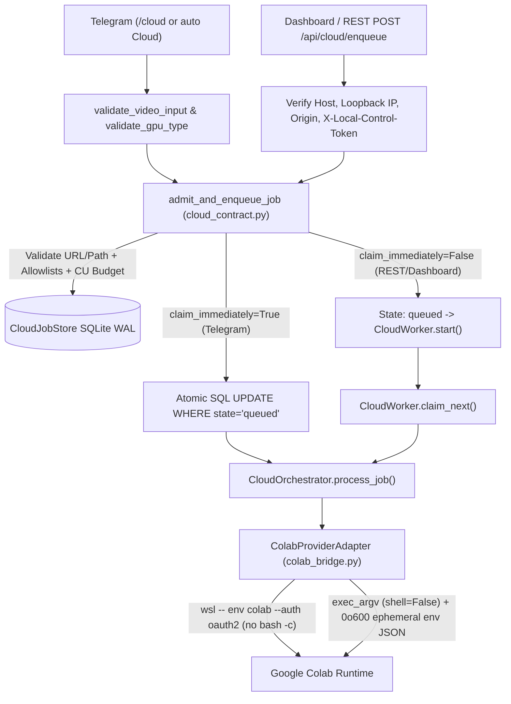

# Cloud Phase 0 Contract & Phase 1 Hardening Record — 14/11/2026

> Tài liệu nghiệm thu **Điều kiện đầu vào #1**, **Giai đoạn 0** và **Giai đoạn 1** cho nhánh phát triển độc lập `codex/cloud-phase0-1-20261114` tại `C:\tool_v1_clean\cloud-phase0-1-20261114`.
> Tài liệu này **không phải chứng nhận Cloud đã sẵn sàng chạy production**: chưa bật `V1_CLOUD_MODE`, chưa thuê GPU, chưa chạy job GPU thật (chỉ kiểm tra CLI đọc `0 CU`).

---

## 1. Đối chiếu Checkout, Môi trường & Port 8089

### 1.1 Đối chiếu các thư mục mã nguồn

| Thư mục | Nhánh Git | HEAD Commit | Vai trò | Ghi chú đối chiếu |
|---|---|---|---|---|
| `C:\tool v1` | `tool-v1` | `4b2d234acc92fead3fc097e570de523089290aa4` | Checkout gốc có thay đổi cục bộ | **Giữ nguyên, không sửa** |
| `C:\Projects\Tools\Tool V1\Updates` | `codex/toolv1-cleanup` | `12face40c24aca01b1ec2b039a0bc0e70529df2d` | Nguồn có `run_cloud_node.py` và test Cloud | **Giữ nguyên, không sửa** |
| `C:\tool_v1_clean\local-cloud-handoff-20261114` | `codex/toolv1-local-cloud-handoff-20261114` | `35483a18d77bc571a53b0ae4f7958b46b0a09b15` | Baseline handoff sạch | Điểm xuất phát tách nhánh Cloud |
| `C:\tool_v1_clean\cloud-phase0-1-20261114` | `codex/cloud-phase0-1-20261114` | Tách từ `35483a18` | **Checkout Cloud có thẩm quyền (Phase 0–1)** | Sửa 5 test OCR + Phase 0 + Phase 1 |

Đối chiếu SHA-256 trước khi áp dụng vá Phase 0–1:
- **12 file Cloud lõi** (`backend/cloud/*.py`, `backend/cloud/gpu_scripts/*`, `backend/templates/cloud_dashboard.html`) và `capcut_tts_api-1.0.0-py3-none-any.whl` giống hệt nhau giữa `C:\tool v1` và `Updates`.
- `backend/telegram_bot.py` trùng SHA-256 `C3BD0E39A3B99C1B0A37CD64806618519D0228FC8CEAA70C82BE42BCD15183C4` giữa `C:\tool v1` và `Updates`.
- `start_cloud_dashboard.bat` khác nhau giữa hai bản gốc:
  - `C:\tool v1\start_cloud_dashboard.bat` (SHA-256 tiền tố `3BB93BE1149E`) chuyển thư mục sang `UPDATES_DIR=C:\Projects\Tools\Tool V1\Updates`.
  - `C:\Projects\Tools\Tool V1\Updates\start_cloud_dashboard.bat` (SHA-256 tiền tố `CF608BEA0B5E`) dùng `cd /d "%~dp0"` chạy `run_cloud_node.py --port 8089`. Checkout chuẩn `C:\tool_v1_clean\cloud-phase0-1-20261114` sử dụng bản `%~dp0`.

### 1.2 Kiểm tra đọc môi trường thực tế (`0 CU`)

- **Cổng `8089`**: không có tiến trình lắng nghe trước khi khởi chạy node.
- **WSL2**: phiên bản `3.0.5.0`, kernel `6.18.58.1-1`.
- **Colab CLI (`/root/.local/bin/colab`)**: phiên bản `0.8.0`.
- **Nhóm lệnh CLI hỗ trợ xác nhận thực tế**: `new`, `sessions`, `status`, `upload`, `exec`, `download`, `stop`, `usage`, `run`, `rm`, `ls`, `log`, `ssh`, `restart-kernel`.
  - Colab CLI `0.8.0` **không có** cờ `--secret` riêng trên dòng lệnh; do đó bí mật chạy phiên (`GEMINI_API_KEY`) được truyền qua file JSON tạm phạm vi phiên với quyền `0o600` và xóa ngay khi đọc trong khối `finally`.

---

## 2. Sơ đồ luồng thực & Điểm Admission Dùng Chung

Trước khi chốt Phase 0, `telegram_bot.py` tự gọi `store.enqueue()` rồi `store.update_progress(..., state="processing")`, tạo cửa sổ tranh chấp nếu `CloudWorker` gọi `claim_next()` cùng lúc. Điểm hợp nhất `admit_and_enqueue_job(...)` trong `backend/cloud/cloud_contract.py` giải quyết vấn đề này bằng kiểm tra đầu vào/ngân sách tập trung và claim nguyên tử khi chạy trực tiếp từ Telegram.

---

## 3. Hợp đồng Dữ liệu (`CloudJobContract`) & Máy Trạng Thái (`CloudJobState`)

### 3.1 Schema chuẩn (`backend/cloud/cloud_contract.py`)

Mỗi job Cloud qua điểm admission sinh bản ghi `CloudJobContract` gồm đầy đủ trường bắt buộc:
- `job_uuid`: UUID v4 duy nhất cho hợp đồng.
- `job_id`: Mã job tương thích `CloudJobStore` (`cloud-YYYYMMDD-HHMMSS-<hex6>`).
- `source_channel`, `source_job_id`: Nguồn (`dashboard`, `telegram`, `api`) và ID job nguồn.
- `input_target`, `display_name`, `remote_filename`: Đầu vào đã chuẩn hóa và tên file POSIX an toàn trên `/content`.
- `input_fingerprint`: `{kind, sha256, size_bytes[, duration_seconds]}` (SHA-256 nội dung file hoặc URL chuẩn).
- `options_snapshot` (`CloudJobOptionsSnapshot`): `{gpu_type, task_type, voice, cu_estimated, cu_budget_daily, output_prefix}`.
- `attempt`: Số lần thử (mặc định `1`).
- `session_ownership` (`CloudSessionOwnership`): `{owner_id, attempt, session_name, lease_expires_at_utc}`.
- Mốc thời gian UTC ISO-8601 (`Z`): `created_at_utc`, `updated_at_utc`, `started_at_utc`, `completed_at_utc`, `deadline_utc`.
- `state` (`CloudJobState`) & `legacy_state` (tương thích `CloudJobStore` trong Phase 0–1).
- `error_code` (`CloudErrorCode`) & `error_message` (đã scrub bí mật).
- `output_manifest` (`CloudOutputManifest`): `{delivery_path, metadata_path, video_sha256, size_bytes, validated}`.

### 3.2 Bảng trạng thái & ánh xạ Legacy

| Trạng thái chuẩn (`CloudJobState`) | Ánh xạ Legacy (Phase 0–1 DB) | Chuyển tiếp hợp lệ (`ALLOWED_TRANSITIONS`) | Ghi chú |
|---|---|---|---|
| `queued` | `queued` | `provisioning`, `cancel_requested`, `cancelling`, `cancelled`, `failed` | Chờ worker claim |
| `provisioning` | `creating_session` | `uploading`, `preparing`, `cancel_requested`, `cancelling`, `failed` | Khởi tạo VM Colab |
| `uploading` | `uploading` | `preparing`, `processing`, `cancel_requested`, `cancelling`, `failed` | Tải bundle/video |
| `preparing` | `processing` | `processing`, `cancel_requested`, `cancelling`, `failed` | Giải nén & setup env |
| `processing` | `processing` | `downloading`, `cancel_requested`, `cancelling`, `failed` | Chạy `full_pipeline.py` |
| `downloading` | `downloading` | `validating`, `completed`, `cancel_requested`, `cancelling`, `failed` | Tải `output_video.mp4` & phụ đề |
| `validating` | `downloading` | `completed`, `cancel_requested`, `cancelling`, `failed` | QC đầu ra (Giai đoạn 5) |
| `cancel_requested` | `stopped` | `cancelling`, `cancelled`, `failed` | Yêu cầu hủy (Giai đoạn 2) |
| `cancelling` | `stopped` | `cancelled`, `failed` | Đang thu hồi session |
| `completed` *(cuối)* | `completed` | *(không nhận chuyển tiếp)* | Trạng thái cuối |
| `cancelled` *(cuối)* | `stopped` | *(không nhận chuyển tiếp)* | Trạng thái cuối |
| `failed` *(cuối)* | `error` | *(không nhận chuyển tiếp)* | Trạng thái cuối |

---

## 4. Danh sách Cấu hình & Feature Flags Cloud

| Nhóm | Khóa / Biến | Giá trị mặc định | Nguồn |
|---|---|---|---|
| Feature Flag | `V1_CLOUD_MODE` | `False` *(mặc định tắt)* | `backend/v1_feature_flags.py` |
| Feature Flag | `V1_CLOUD_GPU` | `"T4"` (`T4/L4/A100/H100/G4/V5E1/V6E1/CPU`) | `backend/v1_feature_flags.py` |
| Cloud Config | `default_gpu` (`AUTODUB_CLOUD_DEFAULT_GPU`) | `"T4"` | `backend/cloud/cloud_config.py` |
| Cloud Config | `cu_budget_daily` (`AUTODUB_CLOUD_CU_BUDGET`) | `10.0` | `backend/cloud/cloud_config.py` |
| Cloud Config | `session_timeout_seconds` (`AUTODUB_CLOUD_SESSION_TIMEOUT`) | `7200` | `backend/cloud/cloud_config.py` |
| Cloud Config | `upload_timeout_seconds` (`AUTODUB_CLOUD_UPLOAD_TIMEOUT`) | `1800` | `backend/cloud/cloud_config.py` |
| Cloud Config | `exec_timeout_seconds` (`AUTODUB_CLOUD_EXEC_TIMEOUT`) | `7200` | `backend/cloud/cloud_config.py` |
| Cloud Config | `download_timeout_seconds` (`AUTODUB_CLOUD_DOWNLOAD_TIMEOUT`) | `1800` | `backend/cloud/cloud_config.py` |
| Cloud Config | `stop_timeout_seconds` (`AUTODUB_CLOUD_STOP_TIMEOUT`) | `60` | `backend/cloud/cloud_config.py` |
| Cloud Config | `wsl_distro` (`AUTODUB_CLOUD_WSL_DISTRO`) | `"Ubuntu"` | `backend/cloud/cloud_config.py` |
| Cloud Config | `wsl_user` (`AUTODUB_CLOUD_WSL_USER`) | `"root"` | `backend/cloud/cloud_config.py` |
| Cloud Config | `results_dir`, `db_path`, `output_prefix` | `backend/cloud/results`, `<workspace>/cloud_jobs.db`, `"cloud_"` | `backend/cloud/cloud_config.py` |
| Security Env | `AUTODUB_LOCAL_TOKEN`, `AUTODUB_WORKSPACE`, `AUTODUB_OUTPUT_DIR`, `AUTODUB_CLOUD_ALLOWED_ROOTS`, `AUTODUB_ALLOW_REMOTE_CLOUD_NODE`, `CLOUD_PORT`, `GEMINI_API_KEY` | Token file nội bộ / `127.0.0.1:8089` | `cloud_security.py`, `run_cloud_node.py` |
| GPU Env Req | `requirements_cloud.txt`, `cloud_env_manifest.json` | Đã pin 15 gói (`==`), wheel SHA256 `capcut_tts_api`, danh sách module/binary/model cố định (Giai đoạn 4) | `backend/cloud/gpu_scripts/requirements_cloud.txt`, `cloud_env_manifest.json` |

---

## 5. Kiểm soát An Toàn Đã Thực Thi ở Giai đoạn 1

1. **`backend/cloud/cloud_security.py`**:
   - Allowlist cố định `ALLOWED_GPU_TYPES`, `ALLOWED_TASK_TYPES`, `ALLOWED_VOICES`, `ALLOWED_URL_SCHEMES` (`http`, `https`), `ALLOWED_VIDEO_EXTENSIONS` (`.mp4`, `.mov`, `.mkv`, `.avi`, `.webm`, `.m4v`, `.ts`), `SESSION_NAME_RE`.
   - `validate_video_input`: chặn ký tự điều khiển, path traversal ra ngoài `allowed_roots`, thư mục giả danh video, file không tồn tại (`404`), tên bắt đầu bằng `-`, scheme nguy hiểm (`file://`, `javascript:`, `ftp://`, `data:`), giữ nguyên tên file hợp lệ chứa dấu nháy `'`, khoảng trắng, `&`, chữ Unicode.
   - `redact_secrets`: xóa `GEMINI_API_KEY`, `AIza...`, `Bearer ...`, `--gemini-key`, query/env token khỏi log, lỗi và `result_metadata.json`.
   - `resolve_local_control_token`, `is_valid_loopback_host`, `is_loopback_client`, `is_valid_loopback_origin`, `allowed_loopback_origins`.
2. **`backend/cloud/colab_bridge.py` (`ColabProviderAdapter`)**:
   - Gọi CLI Colab qua `wsl -- env PATH=... /root/.local/bin/colab --auth oauth2 <argv>` (không qua `bash -c`).
   - `exec_argv` truyền danh sách `argv` nguyên dạng, ghi script runner qua stdin (`0o600`), chạy trên Colab với `subprocess.Popen(argv, shell=False)`, truyền `GEMINI_API_KEY` bằng file JSON tạm phạm vi phiên `0o600` tự xóa trước và trong `finally`.
   - `exec_cmd` từ chối mọi toán tử shell (`;`, `|`, `&&`, `` ` ``, `$(`) và phân tách qua `shlex.split` -> `exec_argv`.
3. **`backend/cloud/cloud_orchestrator.py` & `gpu_scripts/full_pipeline.py`**:
   - Xác thực toàn bộ option/input trước khi tạo session (`0 CU` nếu input lỗi).
   - Chuẩn hóa tên file upload lên `/content` bằng `sanitize_remote_filename`.
   - Scrub bí mật trên mọi log, progress và `result_metadata.json`.
4. **`backend/cloud/cloud_routes.py` & `run_cloud_node.py`**:
   - Router dependency `_verify_local_cloud_request` bảo vệ độc lập ngay cả khi mount ngoài `main.py`.
   - `run_cloud_node.py` khóa CORS chỉ cho loopback (`allowed_loopback_origins()`, `allow_credentials=False`), gắn middleware xác thực Host/IP/Origin/`X-Local-Control-Token`, và từ chối `--host` không phải loopback trừ khi có `AUTODUB_ALLOW_REMOTE_CLOUD_NODE=1`.

---

## 6. Kết quả Kiểm thử & Danh sách Vấn đề Mở (Giai đoạn 3–8)

### 6.1 Kết quả kiểm thử đã quan sát trên nhánh `codex/cloud-phase0-1-20261114`

- **Điều kiện đầu vào #1 (5 test OCR/subtitle lỗi ban đầu + các bộ test OCR/QC liên quan)**:
  - Đã sửa nguồn thực tế tại `backend/ass_utils.py`, `backend/ocr_subtitle_locator.py`, `backend/ocr_utils.py` (không sửa kỳ vọng test).
  - Kết quả chạy 8 bộ test (`test_ocr_geometry_audit.py`, `test_ass_cover_dimensions.py`, `test_subtitle_tracking_regression.py`, `test_v1_ocr_geometry_repair.py`, `test_ocr_adaptive_sampling.py`, `test_ocr_asr_correction.py`, `test_dual_voice_turn_accuracy.py`, `test_v1_qc_policy_source.py`): **112 passed, 1 skipped** (bài skip sẵn trong codebase: `test_source_lifetime_outside_speech_is_covered_without_extending_text`).
- **Giai đoạn 2 — Vòng đời job, lease/heartbeat, hủy thực sự & đối soát phục hồi**:
  - Đã hoàn tất cập nhật `backend/cloud/cloud_contract.py`, `backend/cloud/cloud_job_store.py`, `backend/cloud/colab_bridge.py`, `backend/cloud/cloud_orchestrator.py`, `backend/cloud/cloud_worker.py`, `backend/cloud/cloud_routes.py`, `backend/templates/cloud_dashboard.html`, và bổ sung `tests/test_cloud_phase2_lifecycle.py`.
  - Đã xử lý triệt để lỗi nền `tests/test_cloud_job_store.py::test_job_store_lifecycle`: `CloudJobStore.recover()` và `reconcile_expired_leases()` đối soát lease/session thực tế (phân biệt `provider_unreachable`, không xóa bằng tuổi `created_at > 3h`) và áp dụng máy trạng thái chuẩn Phase 2.
- **Giai đoạn 3 — Ngân sách có thể kiểm toán (`cloud_cost_ledger`) & giữ chỗ CU nguyên tử**:
  - Đã cập nhật `backend/cloud/cloud_config.py`, `backend/cloud/cloud_contract.py`, `backend/cloud/cloud_job_store.py`, `backend/cloud/cloud_orchestrator.py`, `backend/cloud/cloud_routes.py`, `backend/templates/cloud_dashboard.html`, và bổ sung `tests/test_cloud_phase3_cost_ledger.py`.
  - Bổ sung bảng `cloud_cost_ledger` gắn `(job_id, attempt)` tách biệt `estimated`, `buffer`, `reserved`, `observed`, `reconciled`, nguồn đo (`runtime_rate_estimate` là ước tính theo thời gian/hệ số tham khảo, không phải hóa đơn provider), soft-hide lịch sử UI (`delete_job` giữ nguyên sổ chi phí), giữ chỗ ngân sách nguyên tử cùng `claim_next`/`claim_job` trong transaction `BEGIN IMMEDIATE`, phân bổ pro-rata qua nửa đêm theo timezone (`Asia/Ho_Chi_Minh`), giám sát định kỳ lúc chạy và chặn nhận job mới (`BUDGET_UNCERTAIN`) khi provider mất kết nối/dữ liệu cũ hoặc còn session chưa xác nhận thu hồi.
- **Giai đoạn 4 — Dựng môi trường GPU có phiên bản cố định & Tiền kiểm đầu vào/bundle**:
  - Đã cập nhật `backend/cloud/gpu_scripts/requirements_cloud.txt` (pin `==` đồng bộ `requirements.lock.txt`), bổ sung `backend/cloud/gpu_scripts/cloud_env_manifest.json` (pin package/wheel SHA256/binary/module lõi V1/mô hình/GPU family patterns), viết lại `backend/cloud/gpu_scripts/setup_env.py`, cập nhật `backend/cloud/cloud_config.py`, `backend/cloud/cloud_contract.py`, `backend/cloud/cloud_orchestrator.py`, và bổ sung `tests/test_cloud_phase4_env_preflight.py`.
  - `setup_env.py` kiểm tra đĩa trống, nhận diện GPU/CUDA, idempotent theo `.autodub_env_state.json`, phân tách mã thoát thực (`10=ENV_GPU_MISMATCH`, `11=ENV_DISK_INSUFFICIENT`, `12=ENV_NETWORK_ERROR`, `13=ENV_PACKAGE_MISSING`, `14=ENV_MODEL_LOAD_FAILED`, `15=UPLOAD_VERIFICATION_FAILED`), khóa bảo vệ không cho sửa `backend/venv` trên Windows khi thiếu `--allow-local-test`, và xuất `SETUP_ENV_RESULT_JSON` + `env_manifest_result.json`.
  - `CloudOrchestrator.verify_local_preflight` chặn job lỗi (video 0 byte, vượt ngưỡng, hỏng SHA256 wheel, thiếu module V1) ngay với `0 CU` trước khi cấp phát GPU; đóng gói `cloud_env_manifest.json` + `bundle_manifest.json` (kèm kích thước/SHA256 video nguồn), bảo toàn tính nguyên vẹn file video gốc cục bộ, và truyền mã lỗi cấu trúc từ `setup_env.py` sau khi đã thu hồi VM.
  - Toàn bộ 7 bộ test Cloud trước Giai đoạn 5: **46 passed** (`0 CU`, chạy cô lập offline).
- **Giai đoạn 5 — Chặn bản dịch/TTS thiếu (CapCut TTS strict), QC và Xuất thành phẩm an toàn**:
  - Đã cập nhật `backend/cloud/cloud_contract.py` (thêm `TRANSLATION_FAILED`, `TTS_GENERATION_FAILED`, `NO_SPEECH_DETECTED`, `SUBTITLE_BUILD_FAILED`, `RENDER_FAILED`, `QC_FAILED`, `EXPORT_FAILED`), `backend/cloud/cloud_job_store.py` (lưu `output_manifest_json` vào DB & `CloudJob.output_manifest`), `backend/cloud/gpu_scripts/full_pipeline.py`, `backend/cloud/cloud_orchestrator.py`, `backend/telegram_bot.py`, và bổ sung `tests/test_cloud_phase5_quality_export.py`.
  - `full_pipeline.py`: `validate_translation_items` chặn thiếu cue ID / trùng / rỗng / sót chữ nguồn hoặc thiếu `GEMINI_API_KEY` (không giữ nguyên tiếng gốc); `step5_generate_tts` giữ **CapCut TTS (`capcut_tts_api`)** có retry giới hạn, kiểm tra giải mã & thời lượng từng file TTS (`validate_tts_audio_file`), không tự ý đổi sang Edge TTS và chặn xuất BGM-only trừ khi bật `--allow-no-speech`; `verify_rendered_video_qc` kiểm tra stream hình/tiếng & độ lệch thời lượng bằng `ffprobe`, xuất `PIPELINE_RESULT_JSON` và `result_metadata.json`.
  - `CloudOrchestrator`: tải vào thư mục staging theo attempt (`results/<job_id>/attempt_<n>`), kiểm tra `validate_downloaded_output` (lưu `qc_report.json` chẩn đoán khi fail, không đẩy ra thư mục thành phẩm), xuất atomic qua file `.part` + `os.fsync` + `os.replace` với tên chứa `job_id` & `attempt` (`export_deliverable_atomic`), ghi `output_manifest.json` + DB trước khi `completed` và chặn gửi qua Telegram nếu QC fail.
  - Toàn bộ 8 bộ test Cloud (`tests/test_cloud_job_store.py`, `tests/test_cloud_phase1_security.py`, `tests/test_cloud_phase2_lifecycle.py`, `tests/test_cloud_phase3_cost_ledger.py`, `tests/test_cloud_phase4_env_preflight.py`, `tests/test_cloud_phase5_quality_export.py`, `tests/test_cloud_routes.py`, `tests/test_telegram_cloud_integration.py`): **53 passed** (`0 CU`, chạy cô lập offline).
- **Giai đoạn 6 — API, Telegram và Dashboard dùng chung hợp đồng**:
  - Đã cập nhật `backend/cloud/cloud_worker.py` (thêm `peek_cloud_worker()` read-only không tự khởi động worker), `backend/cloud/cloud_job_store.py` (bổ sung cột/index `idempotency_key`, `options_json`, khử trùng lặp giao dịch trong `enqueue`, `get_job_by_idempotency_key`, gắn `error_remediation` trong `to_dict`), `backend/cloud/cloud_contract.py` (`ERROR_REMEDIATION_MAP`, `get_error_remediation`, `validate_idempotency_key`, `_PROVIDER_PROBE_EXECUTOR` tối đa 4 luồng + `_PROVIDER_CONTROL_EXECUTOR` tối đa 2 luồng, single-flight TTL cache `_PROVIDER_CACHE` + `fetch_provider_status_nonblocking`, `run_provider_action_nonblocking`, `get_cloud_status_snapshot`, `request_job_cancellation`, snapshot `execution_mode`/`allow_no_speech`/`extra_options`), `backend/cloud/cloud_routes.py` (`/api/cloud/status` non-blocking & không rò rỉ lambda mới, `/api/cloud/enqueue` hỗ trợ `X-Idempotency-Key`/`idempotency_key`/`options`/`deduplicated`, `/api/cloud/job/cancel` không chặn event loop), `backend/cloud/cloud_config.py` (chặn fallback `.env` ngoài checkout ghi đè `AUTODUB_WORKSPACE`/`AUTODUB_LOCAL_TOKEN`), `backend/telegram_bot.py` (`cmd_cloud`/`cmd_cloud_status` không chặn & snapshot `execution_mode`/`cloud_gpu`/`allow_cloud_fallback=False`/`idempotency_key` chống chạy trùng hoặc đổi mode giữa chừng), `backend/templates/cloud_dashboard.html` (hiển thị stale/reachable cache badge, banner cảnh báo `cancel_requested`/`cancelling` & tài nguyên chờ thu hồi, hướng dẫn khắc phục `error_remediation`, phân rã chi phí ước tính/đang giữ/thực tế, badge `QC Đạt` & đường dẫn thành phẩm, tùy chọn `allow_no_speech`, và `X-Idempotency-Key` chống bấm đúp), cùng `tests/test_cloud_phase6_api_dashboard_telegram.py`.
  - Toàn bộ 9 bộ test Cloud (`tests/test_cloud_job_store.py`, `tests/test_cloud_phase1_security.py`, `tests/test_cloud_phase2_lifecycle.py`, `tests/test_cloud_phase3_cost_ledger.py`, `tests/test_cloud_phase4_env_preflight.py`, `tests/test_cloud_phase5_quality_export.py`, `tests/test_cloud_phase6_api_dashboard_telegram.py`, `tests/test_cloud_routes.py`, `tests/test_telegram_cloud_integration.py`): **58 passed** (`0 CU`, chạy cô lập offline); 8 bộ test OCR/phụ đề/QC local (`tests/test_ocr_geometry_audit.py`, `tests/test_ass_cover_dimensions.py`, `tests/test_subtitle_tracking_regression.py`, `tests/test_v1_ocr_geometry_repair.py`, `tests/test_ocr_adaptive_sampling.py`, `tests/test_ocr_asr_correction.py`, `tests/test_dual_voice_turn_accuracy.py`, `tests/test_v1_qc_policy_source.py`): **112 passed, 1 skipped** (skip sẵn theo `QUARANTINE_STALE` trong `tests/conftest.py`).
- **Giai đoạn 7 — Ma trận nghiệm thu cô lập & Cổng sẵn sàng Canary GPU (`0 CU`)**:
  - Đã cập nhật `backend/cloud/cloud_orchestrator.py` (chuyển tiếp `--allow-no-speech` khi bật, thu hồi thành phẩm mới xuất nếu bị hủy muộn tại `validating`, che bí mật cho lỗi cleanup trong `_verify_or_stop_session` và log), `backend/cloud/cloud_contract.py` (`request_job_cancellation` idempotent khi job đã `cancelled`, dùng `enqueue_or_get` đóng race `X-Idempotency-Key`), `backend/cloud/cloud_job_store.py` (bổ sung `enqueue_or_get` và `_derive_expected_session_name` giúp `recover()` phát hiện VM mồ côi trước `register_session`), `backend/cloud/cloud_security.py` (bổ sung `_COOKIE_HEADER_RE` và `_COOKIE_KV_RE` trong `redact_secrets`), `backend/cloud/cloud_canary.py` (`verify_canary_readiness`, `compare_local_vs_cloud_deliverables` 6 tiêu chí, `render_canary_report_markdown`), `tests/test_cloud_routes.py` (cô lập DB tạm & provider stub), `tests/test_cloud_phase7_acceptance_matrix.py` (10 nhóm ma trận lỗi + Canary gate), và hồ sơ `docs/CLOUD_PHASE7_ACCEPTANCE_AND_CANARY_20261114.md`.
  - Toàn bộ 10 bộ test Cloud: **76 passed** (`0 CU`, chạy cô lập offline; gồm **18 passed** cho `tests/test_cloud_phase7_acceptance_matrix.py`); 8 bộ test OCR/phụ đề/QC local: **112 passed, 1 skipped** (`QUARANTINE_STALE` trong `tests/conftest.py`). `V1_CLOUD_MODE` vẫn giữ mặc định `False`.

### 6.2 Vấn đề còn mở cho các Giai đoạn sau

1. **[Chờ người dùng phê duyệt — Canary GPU thật]**: Chạy thử tối đa 3 ca cô lập (video ngắn 10–30s đối chiếu Local, video tên đặc biệt, ca hủy giữa chừng) chỉ sau khi người dùng cung cấp đường dẫn video được phép tải lên và hạn mức trần CU.
2. **[Mở — Giai đoạn 8]**: Bật có kiểm soát sau Canary đạt chuẩn, theo dõi vận hành và diễn tập khôi phục.
