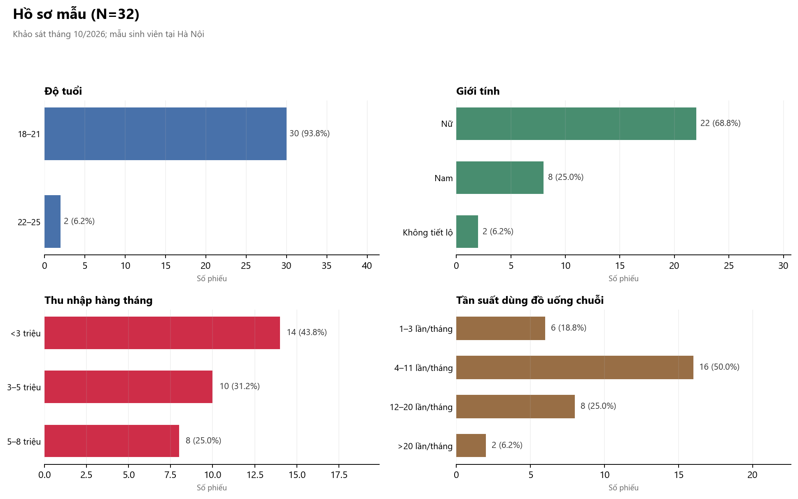
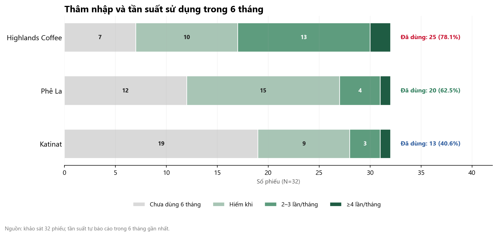
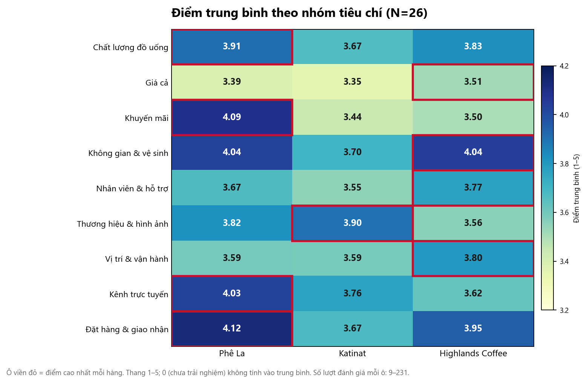
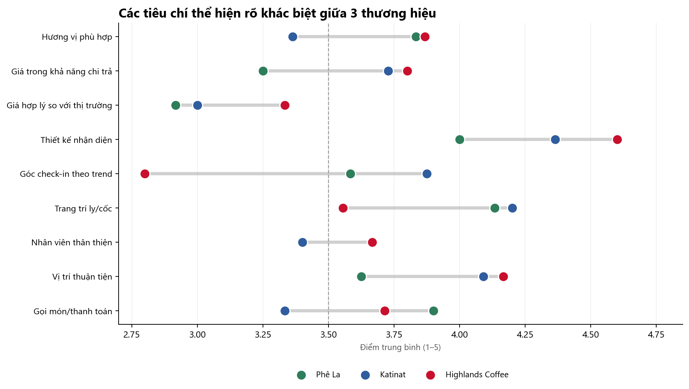
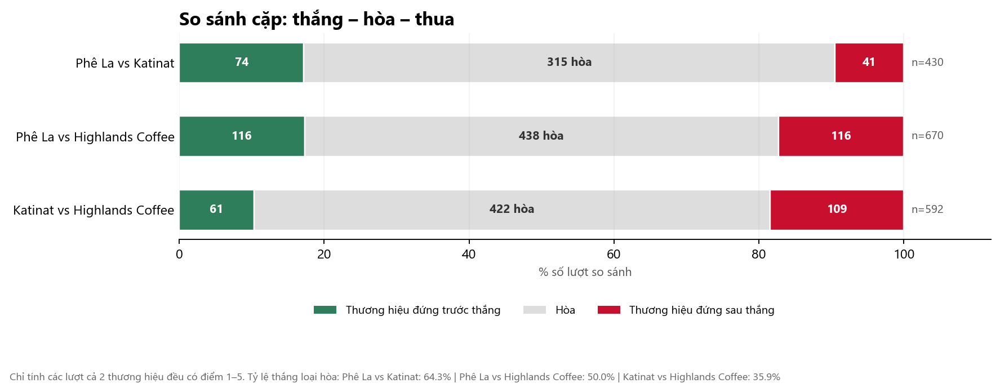

# Phân tích khảo sát hành vi và đánh giá thương hiệu ngành F&B

## Phê La – Katinat – Highlands Coffee

**Báo cáo mô tả** · 32 phiếu hợp lệ · Khảo sát 20–21/10/2026

> Báo cáo chỉ sử dụng dữ liệu tổng hợp, không hiển thị email hay thông tin định danh của người trả lời. Mẫu nhỏ và được chọn theo phương pháp thuận tiện, vì vậy kết quả chỉ mang tính mô tả cho nhóm người tham gia, không đại diện cho toàn bộ thị trường.
>
> **Cỡ mẫu:** 32 phiếu cho hồ sơ/hành vi; 26 phiếu cho phân tích điểm (loại 4 phiếu cùng một mức điểm và 2 phiếu toàn ⓪).

---

## 1. Tóm tắt điều hành

- **Mẫu nghiên cứu:** 32 phiếu, tập trung vào sinh viên Hà Nội: 93,8% từ 18–21 tuổi, 68,8% nữ, 93,8% là sinh viên; 81,3% dùng đồ uống chuỗi từ 4 lần/tháng trở lên. Đây là nhóm khách hàng trẻ, chi tiêu thấp, uống trà là chính và thường dùng quán để học tập/làm việc.
- **Thâm nhập:** Highlands Coffee dẫn đầu rõ rệt với 25/32 người (78,1%) đã dùng trong 6 tháng và 15/32 (46,9%) dùng từ 2–3 lần/tháng trở lên. Phê La đạt 20/32 (62,5%) và 5/32 (15,6%); Katinat thấp nhất với 13/32 (40,6%) và 4/32 (12,5%).
- **Điểm đánh giá:** cả ba thương hiệu đều được đánh giá tích cực, trung bình khoảng 3,66–3,79/5 (N=26). Chênh lệch nhỏ và thay đổi tùy cách tính, nên không nên xếp hạng cứng nhắc. So sánh cặp trên cùng người cho thấy Phê La và Highlands tương đương; cả hai nhỉnh hơn Katinat.
- **Chân dung cạnh tranh:** Phê La mạnh về chất lượng/hương vị, đặt hàng – giao nhận và kênh trực tuyến; Highlands mạnh về không gian, nhân viên, vị trí, giá minh bạch và độ phủ; Katinat mạnh về hình ảnh/thẩm mỹ nhưng thâm nhập thấp và điểm sản phẩm/vận hành còn yếu.
- **Điểm đau chung:** giá là yếu tố quyết định hàng đầu (46,9% chọn) và cũng là nhóm điểm thấp nhất của cả ba thương hiệu (3,35–3,51/5). Trong nhóm giá, các tiêu chí thấp nhất là giá hợp lý so với thị trường, giá tương xứng chất lượng và giá trên sàn thương mại điện tử.
- **Hàm ý chính:** cần gói giá trị dành cho sinh viên, minh bạch giá online – offline, đầu tư trải nghiệm tại quán (nhân viên, không gian học tập) và có chiến dịch tăng dùng thử cho Katinat.

---

## 2. Phương pháp và chất lượng dữ liệu

### 2.1. Nguồn và cấu trúc

- Dữ liệu là file Excel trả lời khảo sát 7 trang, thời gian ghi nhận từ **20/10/2026 18:47** đến **21/10/2026 14:22**.
- File có **33 dòng dữ liệu**, trong đó **32 phiếu hợp lệ** (một dòng không có đánh giá nào).
- Mỗi phiếu chỉ trả lời một trang, tùy theo hình thức trải nghiệm đã chọn. Mỗi trang gồm tổ hợp của ba bảng tiêu chí:
  - **25 tiêu chí chung (G):** áp dụng cho mọi hình thức.
  - **23 tiêu chí online (O):** dành cho người đã đặt giao hàng.
  - **24 tiêu chí offline (F):** dành cho người đã dùng tại quán.
- Tổng cộng **72 tiêu chí**, được chia thành 9 nhóm do người phân tích gán. Đây **không phải** thang đo chính thức của khảo sát.

### 2.2. Xử lý dữ liệu

- Thang điểm ①–⑤ được mã hóa thành **1–5**; ⓪ “Chưa trải nghiệm / Không áp dụng” được mã hóa thành **0** và **loại khỏi trung bình**.
- **4 phiếu** đánh giá tất cả tiêu chí ở cùng một mức điểm (3 phiếu toàn 5, 1 phiếu toàn 3) được loại khỏi phân tích điểm vì không có biến thiên.
- **2 phiếu** đánh dấu ⓪ cho toàn bộ tiêu chí, không có điểm 1–5.
- Còn lại **26 phiếu** có ít nhất một điểm 1–5 và có biến thiên, được dùng cho phân tích điểm.
- Hồ sơ mẫu và hành vi sử dụng **cả 32 phiếu**.
- **1 email** xuất hiện 2 lần nhưng câu trả lời khác nhau; giữ cả hai phiếu và không hiển thị email.
- So sánh cặp chỉ tính những lượt **cả hai thương hiệu đều có điểm 1–5**; tỷ lệ thắng được tính sau khi loại các lượt hòa.
- Một số ít phiếu cho điểm 1–5 cho thương hiệu mà câu hỏi tần suất ghi “chưa dùng trong 6 tháng”; các trường hợp này được giữ nguyên và được xem là hạn chế của dữ liệu tự báo cáo.
- Không thực hiện kiểm định ý nghĩa thống kê do mẫu nhỏ và chọn mẫu thuận tiện.

### 2.3. Chất lượng dữ liệu

| Hạng mục | Số lượng | Ghi chú |
|---|---:|---|
| Tổng dòng trong file | 33 | 1 dòng không có đánh giá |
| Phiếu hợp lệ | 32 | Có ít nhất một khối đánh giá |
| Email duy nhất | 31 | 1 email dùng cho 2 phiếu, câu trả lời khác nhau |
| Phiếu dùng phân tích điểm | 26 | Có điểm 1–5 và có biến thiên |
| Phiếu cùng một mức điểm | 4 | 3 phiếu toàn 5; 1 phiếu toàn 3 |
| Phiếu toàn ⓪ | 2 | Không có điểm 1–5 |
| Trang 1 / 2 / 3 / 4 / 5 / 6 / 7 | 4 / 0 / 10 / 5 / 5 / 2 / 6 | Trang 2 không có phiếu nào |
| Tỷ lệ ⓪ theo thương hiệu (32 phiếu) | 37,5% / 48,6% / 23,2% | Phê La / Katinat / Highlands |

**Điểm cần lưu ý:** trang 2 (chỉ online) không có người trả lời; trang 6 (online + offline) chỉ có 2 phiếu. Vì vậy không nên so sánh kết quả giữa các trang. Phân tích theo tiêu chí được gộp từ các trang, với số lượt mỗi tiêu chí từ 3 đến 18 (trung vị 10).

---

## 3. Hồ sơ mẫu

| Nhóm | Lựa chọn | Số lượng | Tỷ lệ |
|---|---|---:|---:|
| Độ tuổi | Từ 18 đến 21 tuổi | 30 | 93,8% |
| Độ tuổi | Từ 22 đến 25 tuổi | 2 | 6,2% |
| Giới tính | Nữ | 22 | 68,8% |
| Giới tính | Nam | 8 | 25,0% |
| Giới tính | Không muốn tiết lộ | 2 | 6,2% |
| Nghề nghiệp | Sinh viên | 30 | 93,8% |
| Nghề nghiệp | Khác (thực tập sinh, freelancer, vừa học vừa làm) | 2 | 6,2% |
| Thu nhập hàng tháng | Dưới 3 triệu đồng | 14 | 43,8% |
| Thu nhập hàng tháng | Từ 3 – dưới 5 triệu đồng | 10 | 31,2% |
| Thu nhập hàng tháng | Từ 5 – dưới 8 triệu đồng | 8 | 25,0% |
| Khu vực | Hai Bà Trưng | 14 | 43,8% |
| Khu vực | Thanh Xuân | 4 | 12,5% |
| Khu vực | Đống Đa | 3 | 9,4% |
| Khu vực | Ba Đình | 2 | 6,2% |
| Khu vực | Bạch Mai | 2 | 6,2% |
| Khu vực | Cầu Giấy | 2 | 6,2% |
| Khu vực | Khác (không xác định, Hoàn Kiếm, Nam Từ Liêm, Gia Lâm) | 5 | 15,6% |

*Ghi chú: một phiếu ghi “Đống Đa và HBT” được xếp vào Hai Bà Trưng; nhóm “Khác” gồm 2 phiếu không xác định, 1 Hoàn Kiếm, 1 Nam Từ Liêm và 1 Gia Lâm. Địa bàn chỉ mang tính tham khảo, không dùng để suy rộng.*



**Đọc nhanh:** mẫu gần như đồng nhất về tuổi và nghề nghiệp, thu nhập thấp. Vì vậy kết quả phù hợp để hiểu nhóm sinh viên trẻ tại Hà Nội, không đại diện cho khách hàng đi làm hay nhóm thu nhập cao.

---

## 4. Hành vi tiêu dùng

### 4.1. Tần suất, hình thức và chi tiêu

| Nhóm | Lựa chọn | Số lượng | Tỷ lệ |
|---|---|---:|---:|
| Tần suất dùng đồ uống chuỗi | 1–3 lần/tháng | 6 | 18,8% |
| Tần suất dùng đồ uống chuỗi | 4–11 lần/tháng | 16 | 50,0% |
| Tần suất dùng đồ uống chuỗi | 12–20 lần/tháng | 8 | 25,0% |
| Tần suất dùng đồ uống chuỗi | Trên 20 lần/tháng | 2 | 6,2% |
| Hình thức tiêu dùng | Kết hợp linh hoạt cả online và offline | 21 | 65,6% |
| Hình thức tiêu dùng | Thuần offline | 8 | 25,0% |
| Hình thức tiêu dùng | Thuần online | 2 | 6,2% |
| Hình thức tiêu dùng | Mua mang đi tại quầy | 1 | 3,1% |
| Chi tiêu mỗi lần | Dưới 40.000 đồng | 9 | 28,1% |
| Chi tiêu mỗi lần | 40.000–60.000 đồng | 17 | 53,1% |
| Chi tiêu mỗi lần | 61.000–80.000 đồng | 6 | 18,8% |

**Điểm đáng chú ý:** 81,3% dùng từ 4 lần/tháng trở lên; 81,3% chi dưới 60.000 đồng/lần. Đây là nhóm có tần suất cao nhưng ngân sách hạn chế – điều kiện thuận lợi cho các gói combo giá trị và chương trình tích điểm.

### 4.2. Bối cảnh sử dụng

| Nhóm | Lựa chọn | Số lượng | Tỷ lệ |
|---|---|---:|---:|
| Đi cùng ai | Bạn bè / bạn học | 17 | 53,1% |
| Đi cùng ai | Một mình | 12 | 37,5% |
| Đi cùng ai | Người yêu | 2 | 6,2% |
| Đi cùng ai | Gia đình | 1 | 3,1% |
| Thời gian | Buổi chiều (15:00–18:00) | 14 | 43,8% |
| Thời gian | Buổi tối (19:00–22:00) | 10 | 31,2% |
| Thời gian | Buổi sáng (07:00–11:00) | 6 | 18,8% |
| Thời gian | Buổi trưa (12:00–14:00) | 5 | 15,6% |
| Thời gian | Đêm muộn (sau 22:00) | 1 | 3,1% |

*Thời gian là câu hỏi nhiều lựa chọn nên tổng tỷ lệ lớn hơn 100%.*

### 4.3. Mục đích, đồ uống, kênh thông tin và yếu tố quyết định

| Nhóm | Lựa chọn | Số lượng | Tỷ lệ |
|---|---|---:|---:|
| Mục đích sử dụng | Học tập / làm việc / chạy deadline | 20 | 62,5% |
| Mục đích sử dụng | Thưởng thức hương vị | 5 | 15,6% |
| Mục đích sử dụng | Gặp gỡ, kết nối | 4 | 12,5% |
| Mục đích sử dụng | Không gian đẹp / check-in | 2 | 6,2% |
| Mục đích sử dụng | Nhanh chóng / tiện lợi | 2 | 6,2% |
| Đồ uống thường chọn | Trà đậm vị / trà sữa | 21 | 65,6% |
| Đồ uống thường chọn | Đá xay / Freeze | 7 | 21,9% |
| Đồ uống thường chọn | Cà phê pha máy | 3 | 9,4% |
| Đồ uống thường chọn | Cà phê truyền thống | 3 | 9,4% |
| Đồ uống thường chọn | Trà hoa quả / nước ép | 2 | 6,2% |
| Kênh thông tin | Video review / TikTok | 14 | 43,8% |
| Kênh thông tin | Bạn bè / người quen giới thiệu | 11 | 34,4% |
| Kênh thông tin | Vị trí cửa hàng nổi bật | 8 | 25,0% |
| Kênh thông tin | Ưu đãi / mã giảm giá | 6 | 18,8% |
| Kênh thông tin | Fanpage / Instagram | 3 | 9,4% |
| Yếu tố quyết định | Giá hợp lý / nhiều ưu đãi | 15 | 46,9% |
| Yếu tố quyết định | Tiện nghi ngồi lâu (bàn ghế, ổ điện, wifi) | 11 | 34,4% |
| Yếu tố quyết định | Hương vị thơm ngon | 8 | 25,0% |
| Yếu tố quyết định | Hợp thời / bắt trend | 6 | 18,8% |
| Yếu tố quyết định | Không gian đẹp / chụp ảnh | 5 | 15,6% |
| Yếu tố quyết định | Phục vụ nhanh / thân thiện | 5 | 15,6% |
| Yếu tố quyết định | Đóng gói cẩn thận | 4 | 12,5% |
| Yếu tố quyết định | Vị trí / gửi xe thuận tiện | 4 | 12,5% |

**Đọc nhanh:** nhu cầu học tập/làm việc chiếm ưu thế rõ rệt (62,5%), đi kèm nhu cầu tiện nghi ngồi lâu (34,4%). Giá là yếu tố quyết định số một (46,9%), nhưng hương vị chỉ được 25,0% chọn – cho thấy “giá và sự tiện” được ưu tiên hơn “ngon” trong nhóm này. Kênh khám phá chính là TikTok/review (43,8%) và bạn bè (34,4%), trong khi fanpage chỉ 9,4%.

---

## 5. Thâm nhập và tần suất sử dụng thương hiệu



| Thương hiệu | Chưa dùng 6 tháng | Hiếm khi | 2–3 lần/tháng | ≥4 lần/tháng | Đã dùng 6 tháng | Thường xuyên (từ 2–3 lần/tháng) |
|---|---:|---:|---:|---:|---:|---:|
| Phê La | 12 (37,5%) | 15 (46,9%) | 4 (12,5%) | 1 (3,1%) | 20 (62,5%) | 5 (15,6%) |
| Katinat | 19 (59,4%) | 9 (28,1%) | 3 (9,4%) | 1 (3,1%) | 13 (40,6%) | 4 (12,5%) |
| Highlands Coffee | 7 (21,9%) | 10 (31,3%) | 13 (40,6%) | 2 (6,3%) | 25 (78,1%) | 15 (46,9%) |

### 5.1. Kênh trải nghiệm

| Thương hiệu | Đã từng trải nghiệm | Chỉ offline | Chỉ online | Cả hai kênh |
|---|---:|---:|---:|---:|
| Phê La | 18 | 10 (55,6%) | 2 (11,1%) | 6 (33,3%) |
| Katinat | 15 | 4 (26,7%) | 3 (20,0%) | 8 (53,3%) |
| Highlands Coffee | 28 | 13 (46,4%) | 2 (7,1%) | 13 (46,4%) |

*Đơn vị: số người; tỷ lệ tính trên số người đã từng trải nghiệm từng thương hiệu.*

### 5.2. Nhận định

- **Highlands là lựa chọn “mặc định” của nhóm sinh viên:** 78,1% đã dùng trong 6 tháng, gần một nửa dùng từ 2–3 lần/tháng trở lên. Đây là lợi thế về độ phủ và thói quen.
- **Phê La có tệp người dùng nhỏ hơn và chủ yếu dùng không thường xuyên:** 62,5% đã dùng, nhưng chỉ 15,6% dùng thường xuyên; phần lớn ở mức “hiếm khi” (46,9%).
- **Katinat là thương hiệu cần tăng dùng thử nhất:** 59,4% chưa dùng trong 6 tháng; chỉ 12,5% dùng từ 2–3 lần/tháng trở lên. Đây là ưu tiên số một của Katinat: mở rộng dùng thử trước khi tối ưu giá hay hình ảnh.
- **Kênh:** 65,6% dùng cả online và offline; chỉ 6,2% thuần online. Vì vậy online là kênh song hành, không thay thế trải nghiệm tại quán.

---

## 6. Đánh giá thương hiệu

### 6.1. Điểm tổng

**N=26 phiếu có điểm 1–5 và có biến thiên.**

| Thương hiệu | n lượt đánh giá | Điểm trung bình | % 4–5 | % 5 | % ≤ 2 |
|---|---:|---:|---:|---:|---:|
| Phê La | 742 | 3,79 | 56,3% | 29,5% | 6,2% |
| Katinat | 592 | 3,66 | 50,7% | 23,8% | 7,4% |
| Highlands Coffee | 937 | 3,72 | 56,5% | 23,2% | 6,9% |

**Cảnh báo cách đọc:** mỗi thương hiệu được đánh giá bởi một tập người và số lượt khác nhau (Katinat có ít người dùng hơn), nên không nên dùng bảng này để xếp hạng trực tiếp. Điểm trung bình thay đổi tùy cách tính:

| Cách tính | Phê La | Katinat | Highlands |
|---|---:|---:|---:|
| Trung bình tất cả lượt đánh giá (N=26) | 3,79 (742) | 3,66 (592) | 3,72 (937) |
| Trung bình theo từng người (mỗi người 1 trọng số) | 3,91 (24) | 3,98 (21) | 3,89 (29) |
| Giữ cả 32 phiếu | 3,93 (843) | 3,84 (693) | 3,84 (1.037) |

Thứ hạng không ổn định giữa các cách tính. Kết luận hợp lý là **ba thương hiệu được đánh giá khá sát nhau, cùng ở mức tích cực (khoảng 3,7–4,0/5)**; khác biệt nhỏ, khó tách khỏi dao động ngẫu nhiên của một mẫu 26–32 người. Phần so sánh cặp ở mục 6.5 là căn cứ đáng tin hơn để nói thương hiệu nào nhỉnh hơn.

### 6.2. Hình ảnh thương hiệu phù hợp với phong cách người trả lời

Câu hỏi: “Hình ảnh thương hiệu hướng đến phù hợp với phong cách của tôi” (1–5).

| Thương hiệu | n | Trung bình | Trung vị | % 4–5 | Phân bố 1 / 2 / 3 / 4 / 5 |
|---|---:|---:|---:|---:|---|
| Phê La | 23 | 3,70 | 4 | 52,2% | 0 / 2 / 9 / 6 / 6 |
| Katinat | 20 | 3,25 | 3 | 35,0% | 1 / 4 / 8 / 3 / 4 |
| Highlands Coffee | 26 | 3,81 | 4 | 57,7% | 1 / 2 / 8 / 5 / 10 |

Trong nhóm **18 người trả lời cả ba thương hiệu**, điểm lần lượt là **Phê La 3,78 – Katinat 3,11 – Highlands 4,06**. Khoảng cách này lớn hơn nhiều so với điểm tổng, cho thấy Highlands có hình ảnh gần gũi nhất với phong cách của nhóm sinh viên được hỏi; Katinat dù được nhìn nhận “đẹp” nhưng chưa tạo được sự đồng điệu cá nhân.

Hình ảnh phù hợp có tương quan thuận với điểm tổng, rõ nhất ở Highlands (r ≈ 0,69; n=22), thấp hơn ở Phê La (r ≈ 0,38; n=18) và Katinat (r ≈ 0,31; n=14). Đây chỉ là tương quan mô tả trên mẫu nhỏ, không phải quan hệ nhân quả.

### 6.3. Điểm theo nhóm tiêu chí



| Nhóm tiêu chí | Phê La | Katinat | Highlands Coffee |
|---|---:|---:|---:|
| Chất lượng đồ uống | 3,91 | 3,67 | 3,83 |
| Giá cả | 3,39 | 3,35 | 3,51 |
| Khuyến mãi | 4,09 | 3,44 | 3,50 |
| Không gian & vệ sinh | 4,04 | 3,70 | 4,04 |
| Nhân viên & hỗ trợ | 3,67 | 3,55 | 3,77 |
| Thương hiệu & hình ảnh | 3,82 | 3,90 | 3,56 |
| Vị trí & vận hành | 3,59 | 3,59 | 3,80 |
| Kênh trực tuyến | 4,03 | 3,76 | 3,62 |
| Đặt hàng & giao nhận | 4,12 | 3,67 | 3,95 |

*N=26; số lượt đánh giá mỗi ô từ 9 đến 231. Các nhóm do người phân tích gán, không phải thang đo chính thức.*

**Đọc nhanh:**

- **Phê La** dẫn đầu ở khuyến mãi (4,09), kênh trực tuyến (4,03), đặt hàng & giao nhận (4,12) và chất lượng (3,91). Đây là thương hiệu của “sản phẩm và trải nghiệm số”.
- **Highlands** dẫn đầu ở giá (3,51), nhân viên (3,77), vị trí & vận hành (3,80); đồng hạng nhất về không gian & vệ sinh (4,04). Đây là thương hiệu của “vận hành và độ phủ”.
- **Katinat** chỉ dẫn đầu ở thương hiệu & hình ảnh (3,90), nhưng thấp hơn ở chất lượng (3,67), giá (3,35), nhân viên (3,55) và đặt hàng (3,67).
- **Giá là điểm yếu chung:** cả ba đều dưới 3,6, thấp hơn rõ rệt so với các nhóm còn lại. **Không gian và đặt hàng/giao nhận** đều nằm trong nhóm điểm cao của cả ba (3,67–4,12), trong khi giá thấp nhất.

### 6.4. Điểm mạnh – điểm yếu theo tiêu chí



*Các tiêu chí trong mục này có n≥8; một số tiêu chí online/offline có n nhỏ hơn (3–7) không được xếp hạng.*

**Phê La**

- **Mạnh:** thực hiện đúng món/đủ số lượng (4,60; n=10), thông báo tình trạng món (4,36; n=11), không gian sạch sẽ (4,36; n=11), đáp ứng tùy chỉnh (4,27; n=11), đa dạng thanh toán (4,25; n=12).
- **Yếu:** giá trên sàn TMĐT chưa nhất quán (2,91; n=11), giá hợp lý so với thị trường (2,92; n=12), giá hợp lý tại quán (3,13; n=15), giá trong khả năng chi trả (3,25; n=12), giá tương xứng chất lượng (3,33; n=12). Nhân viên thân thiện (3,40; n=15) cũng là điểm cần cải thiện.

**Katinat**

- **Mạnh:** thực hiện đúng món/đủ số lượng (4,40; n=10), thiết kế nhận diện (4,36; n=11), giá minh bạch (4,30; n=10), trang trí ly/cốc (4,20; n=10), hình ảnh hiện đại (4,18; n=11), góc check-in theo trend (4,10; n=10).
- **Yếu:** giá hợp lý tại quán (3,00; n=10), giá hợp lý so với thị trường (3,00; n=11), giá tương xứng chất lượng (3,09; n=11), giá tương xứng chất lượng tại quán (3,10; n=10), đáp ứng kỳ vọng (3,18; n=11), giá trên sàn TMĐT chưa nhất quán (3,18; n=11). Bãi đỗ xe (3,33; n=9) và thời gian chờ (3,33; n=9) cũng thấp.

**Highlands Coffee**

- **Mạnh:** thiết kế nhận diện (4,60; n=15), thực hiện đúng món/đủ số lượng (4,47; n=15), không gian sạch sẽ (4,40; n=15), đa dạng thanh toán (4,27; n=15), giá minh bạch tại quán (4,18; n=17), vị trí thuận tiện (4,17; n=18), giá minh bạch (4,14; n=14), nhân viên nắm thực đơn (4,06; n=17).
- **Yếu:** góc check-in theo trend (2,80; n=15), giá hợp lý tại quán (2,94; n=18), giá trên sàn TMĐT chưa nhất quán (3,20; n=15), lựa chọn cho dịp quan trọng (3,24; n=17), bắt kịp xu hướng tại quán (3,25; n=16), giá hợp lý so với thị trường (3,33; n=15).

**Nhận định:** ba thương hiệu có chân dung rất khác nhau. Highlands có nhận diện thiết kế mạnh nhất (4,60) nhưng yếu nhất ở hình ảnh “trend/check-in” (2,80) – tức là được nhận ra ngay nhưng chưa được xem là nơi để “sống ảo”. Phê La mạnh ở sản phẩm và quy trình, yếu ở giá và nhân viên. Katinat mạnh ở thẩm mỹ nhưng yếu ở giá, chất lượng và vận hành.

### 6.5. So sánh cặp



| Cặp so sánh | Thắng | Hòa | Thua | n | Tỷ lệ thắng (không hòa) | Chênh lệch TB |
|---|---:|---:|---:|---:|---:|---:|
| Phê La vs Katinat | 74 | 315 | 41 | 430 | 64,3% | +0,10 |
| Phê La vs Highlands | 116 | 438 | 116 | 670 | 50,0% | +0,07 |
| Katinat vs Highlands | 61 | 422 | 109 | 592 | 35,9% | −0,12 |

*“Thắng/Thua” tính cho thương hiệu đứng trước. Tỷ lệ thắng đã loại các lượt hòa.*

**Đọc nhanh:**

- **Phê La và Highlands gần như ngang nhau:** 50,0% lượt không hòa nghiêng về Phê La, chênh lệch trung bình chỉ +0,07 điểm.
- **Phê La nhỉnh hơn Katinat:** thắng 64,3% lượt không hòa, chênh lệch +0,10 điểm.
- **Highlands nhỉnh hơn Katinat:** Katinat chỉ thắng 35,9% lượt không hòa (Highlands thắng 64,1%), chênh lệch −0,12 điểm.
- **Tỷ lệ hòa rất cao:** 65,4–73,3% số lượt so sánh là hòa. Điều này cho thấy nhiều người cho điểm giống nhau cho cả ba thương hiệu, có thể do xu hướng cho điểm cao hoặc ít phân biệt giữa các brand. Vì vậy tỷ lệ thắng chỉ nên đọc như một tín hiệu, không phải kết luận mạnh.

---

## 7. Liên tưởng thương hiệu (dữ liệu định tính)

*Mỗi thương hiệu có 2 câu hỏi mở; mỗi câu có khoảng 10–19 câu trả lời. Dữ liệu không đại diện cho toàn mẫu; dưới đây là các chủ đề lặp lại, không trích dẫn thông tin cá nhân.*

### Phê La

- **Liên tưởng tích cực:** “đậm trà”, “ngon”, “đẹp”, “chill”, “thuần Việt”, “trẻ trung”, “không gian đẹp”.
- **Liên tưởng tiêu cực:** “đắt” xuất hiện lặp lại; một số ý kiến cho rằng “đắt nhưng xắt ra miếng”, số khác lại thấy “đắt, lâu, nước nhạt”.
- **Bối cảnh sử dụng:** đi study date, đi chơi với bạn bè/người thân, chạy deadline, thèm vị trà, dịp kỷ niệm.
- **Hàm ý:** chất lượng là tài sản chính; giá cao được chấp nhận khi chất lượng được cảm nhận rõ, nhưng không phải ai cũng thấy xứng đáng. Cần truyền thông “giá trị” thay vì chỉ giảm giá.

### Katinat

- **Liên tưởng tích cực:** “đẹp”, “hiện đại”, “bắt trend”, “trẻ trung”, “sang”, “bao bì đẹp”.
- **Liên tưởng tiêu cực:** “đắt”, “tệ”, “đông”, “bình thường”, “đắt, không ngon lắm”.
- **Bối cảnh sử dụng:** hẹn hò, tụ tập bạn bè, thấy mã giảm giá trên app.
- **Tín hiệu đáng lưu ý:** nhiều câu trả lời là “chưa uống bao giờ”, “chưa trải nghiệm”, “không chọn”. Katinat được biết đến qua hình ảnh nhưng thiếu trải nghiệm thực tế; một số người đã thử và thấy không xứng với kỳ vọng.

### Highlands Coffee

- **Liên tưởng tích cực:** “tiện”, “nhiều cơ sở”, “giá hợp lý”, “giá minh bạch”, “ổn”, “cổ điển”, “cozy”, “sạch sẽ”.
- **Liên tưởng tiêu cực:** “ồn”, “đông”, “không đặc biệt”, “ít”, “hơi đắt”.
- **Bối cảnh sử dụng:** học tập, chạy deadline, làm việc, gặp bạn bè; là lựa chọn “mặc định” khi không có quán nào khác hoặc khi cần chỗ ngồi lâu.
- **Hàm ý:** Highlands thắng bằng sự tiện lợi và độ tin cậy, nhưng đang đối mặt rủi ro “bình thường hóa” – khách chọn vì tiện chứ không vì yêu thích. Cần thêm yếu tố cảm xúc/khám phá để giữ chân nhóm trẻ.

---

## 8. Insight và khuyến nghị

### 8.1. Insight chính

1. **Giá là điểm đau chung, không phải lợi thế của riêng ai.** 46,9% chọn giá là yếu tố quyết định; điểm nhóm giá thấp nhất ở cả ba (3,35–3,51). Trong nhóm giá, các tiêu chí thấp nhất là giá hợp lý so với thị trường, giá tương xứng chất lượng và giá trên sàn TMĐT. Đây là cơ hội cho gói combo, minh bạch giá và cam kết giá online – offline.
2. **Highlands sở hữu “occasion” học tập/làm việc nhưng thiếu “occasion” check-in.** 62,5% dùng quán để học/làm việc; Highlands mạnh về không gian sạch (đồng hạng), vị trí, nhân viên và giá minh bạch. Nhưng điểm check-in theo trend chỉ 2,80 và “bắt kịp xu hướng” 3,25 – thấp nhất trong ba brand. Đây là khoảng trống để làm mới hình ảnh mà không phá vỡ tệp khách học tập.
3. **Phê La thắng bằng sản phẩm và trải nghiệm số, nhưng giá và nhân viên là rào cản.** Phê La dẫn đầu về khuyến mãi, kênh trực tuyến, đặt hàng/giao nhận và chất lượng; điểm thấp nhất là giá (2,91–3,27) và nhân viên thân thiện (3,40). Đây là thương hiệu có thể bán “chất lượng” thay vì “giá rẻ”, nhưng cần làm rõ giá trị và cải thiện thái độ phục vụ.
4. **Katinat có tài sản hình ảnh nhưng chưa chuyển hóa thành dùng thử.** Katinat dẫn đầu về thương hiệu & hình ảnh (3,90), thiết kế nhận diện (4,36), check-in (4,10), nhưng 59,4% chưa dùng trong 6 tháng; nhóm chất lượng (3,67), nhóm giá (3,35), nhóm nhân viên (3,55) và nhóm đặt hàng (3,67) đều thấp. Vấn đề không chỉ là truyền thông mà là trải nghiệm thực tế sau khi thử.
5. **Online là điều kiện cần, offline là nơi tạo khác biệt.** 65,6% dùng cả hai kênh; điểm online của Phê La cao (4,03) nhưng không có brand nào thấp dưới 3,6. Trong khi đó, các điểm yếu tập trung ở trải nghiệm tại quán: nhân viên, bãi đỗ xe, thời gian chờ, không gian check-in. Đầu tư vào vận hành cửa hàng quan trọng hơn chạy thêm khuyến mãi app.
6. **Kênh khám phá: TikTok/review và bạn bè.** 43,8% biết qua video review/TikTok, 34,4% qua bạn bè; fanpage chỉ 9,4%. Đây là kênh nên ưu tiên, đặc biệt với nhóm sinh viên.
7. **Thời điểm và bối cảnh:** chiều/tối là cao điểm; học tập/làm việc là mục đích chính; tiện nghi ngồi lâu là yếu tố quyết định của 34,4%. Các gói “combo chiều” và không gian học tập là đòn bẩy tự nhiên.
8. **Người dùng thường xuyên hơn có điểm trung bình cao hơn người dùng hiếm khi.** Trong nhóm đã dùng, nhóm từ 2–3 lần/tháng trở lên đạt điểm cao hơn nhóm hiếm khi: Highlands 3,81–4,63 so với 3,60; Phê La 4,63 so với 3,62; Katinat 4,13–5,00 so với 3,56 (cỡ nhóm 1–12 người). Quan hệ có thể là nhân quả hai chiều (dùng nhiều → hài lòng hơn, hoặc hài lòng hơn → dùng nhiều), nhưng củng cố kết luận: **tăng tần suất trải nghiệm là cách cải thiện đánh giá bền vững**, đặc biệt với Katinat.

### 8.2. Khuyến nghị theo thương hiệu

| Thương hiệu | Ưu tiên | Hành động cụ thể | Chỉ số theo dõi |
|---|---|---|---|
| **Phê La** | Biến chất lượng thành giá trị cảm nhận; giảm rào cản giá | Gói combo sinh viên 39–49k (đồ uống + bánh/snack); happy hour 14:00–17:00; thẻ tích điểm; giữ giá online – offline nhất quán; đào tạo nhân viên chào đón/thân thiện | Điểm “giá tương xứng chất lượng”; tỷ lệ quay lại; điểm nhân viên thân thiện; %4–5 |
| **Highlands Coffee** | Làm mới hình ảnh check-in/trend mà vẫn giữ lợi thế học tập | Góc check-in theo mùa; ly/cốc phiên bản giới hạn; nội dung TikTok/KOC; cuộc thi ảnh người dùng; set quà tặng/dịp đặc biệt; giữ wifi, ổ điện, khu yên tĩnh | Điểm check-in/trend; %4–5 hình ảnh; tỷ lệ khách dùng cho dịp đặc biệt; độ phủ |
| **Katinat** | Tăng dùng thử và chuyển hóa thành lần quay lại | Ưu đãi đơn đầu trên app giao hàng; sampling tại trường; combo sinh viên; giới thiệu bạn bè; ổn định chất lượng và thái độ nhân viên; cải thiện chỗ đỗ xe/thời gian chờ | Tỷ lệ đã dùng 6 tháng; tỷ lệ dùng ≥2–3 lần/tháng; tỷ lệ quay lại sau lần đầu; điểm chất lượng/nhân viên |

### 8.3. Khuyến nghị chung

- **Gói giá trị cho sinh viên:** combo 39–49k, ưu đãi theo khung giờ chiều, tích điểm đổi đồ uống. Truyền thông bằng con số cụ thể (“từ 39k”) thay vì giảm giá chung.
- **Minh bạch giá đa kênh:** đảm bảo giá trên app, sàn TMĐT và tại quán nhất quán; công bố phụ phí (nếu có). Đây là điểm thấp nhất của Phê La (2,91) và cũng là điểm yếu của Highlands (3,20) và Katinat (3,18).
- **Đầu tư trải nghiệm tại quán:** nhân viên thân thiện, tốc độ phục vụ, bãi đỗ xe, khu học tập yên tĩnh, wifi/ổ điện. Đây là nơi tạo khác biệt mà online không thay thế được.
- **Truyền thông qua TikTok/review và bạn bè:** hợp tác KOC sinh viên, video review chân thực, mã giới thiệu bạn bè; hạn chế dựa vào fanpage.
- **Đo lường lại:** khảo sát follow-up với cỡ mẫu lớn hơn, đo nhận biết – xem xét – dùng thử – quay lại – NPS; theo dõi riêng nhóm Katinat để kiểm tra hiệu quả chiến dịch dùng thử.

---

## 9. Hạn chế

- **Mẫu nhỏ, chọn mẫu thuận tiện:** N=32, chủ yếu là sinh viên 18–21 tuổi tại Hà Nội, thu nhập dưới 5 triệu. Không đại diện cho toàn bộ khách hàng ngành F&B, không suy rộng ra thị trường.
- **Thiết kế 7 trang:** trang 2 không có người trả lời, trang 6 chỉ có 2 phiếu; không thể so sánh giữa các nhóm trang. Các tiêu chí online/offline có số lượt nhỏ (3–18; trung vị 10).
- **Xử lý ngoại lệ:** 4 phiếu cùng một mức điểm bị loại khỏi phân tích điểm; 2 phiếu toàn ⓪; 1 email dùng 2 lần. Kết quả có thể thay đổi nếu giữ các phiếu này.
- **Điểm đánh giá có điều kiện và có mâu thuẫn nhỏ:** phần lớn người đánh giá là người đã dùng, nhưng một số ít trường hợp vẫn cho điểm 1–5 dù khai “chưa dùng trong 6 tháng” – cho thấy dữ liệu tự báo cáo chưa hoàn toàn nhất quán. Tỷ lệ ⓪ trên toàn bộ 32 phiếu là 37,5% với Phê La, 48,6% với Katinat và 23,2% với Highlands. Người chưa dùng có thể có quan điểm khác.
- **Nhiều lượt hòa:** 65,4–73,3% lượt so sánh cặp là hòa; tỷ lệ thắng chỉ dựa trên 115–232 lượt không hòa, tập trung ở 26 người. Kết quả so sánh cặp có thể thay đổi với mẫu lớn hơn.
- **Không kiểm định ý nghĩa thống kê:** mọi khác biệt dưới 0,1–0,2 điểm chỉ nên xem là tín hiệu, không phải kết luận chắc chắn.
- **Dữ liệu tự báo cáo:** có thể có sai lệch do hồi tưởng hoặc mong muốn thể hiện bản thân.
- **9 nhóm tiêu chí do người phân tích gán:** không phải thang đo đã kiểm định; việc gộp nhóm có thể ảnh hưởng đến điểm trung bình nhóm.
- **Dữ liệu định tính ít:** 10–19 câu trả lời mỗi câu hỏi mở, không đại diện; chỉ dùng để minh họa.

---

## Phụ lục

### A. File dữ liệu và bảng chi tiết

- Excel tổng hợp: [`outputs/khao_sat_ncm/PHAN_TICH_KHAO_SAT_NCM.xlsx`](../outputs/khao_sat_ncm/PHAN_TICH_KHAO_SAT_NCM.xlsx)
- Các sheet chính:
  - `Doc`: phương pháp, xử lý ngoại lệ, cảnh báo.
  - `Ho so mau`, `Hanh vi`, `Tham nhap`, `Kenh`: hồ sơ và hành vi.
  - `Diem tong`, `Hinh anh`, `Hinh anh (cap)`, `Diem theo nhom`: điểm đánh giá.
  - `Chi tiet tieu chi`: 72 tiêu chí × 3 thương hiệu, kèm n, điểm TB, %4–5, %⓪.
  - `So sanh cap`: thắng – hòa – thua theo từng cặp.
  - `Dinh tinh`: câu trả lời mở (không có email/tên).
  - `Du lieu sach`: bảng dài phục vụ kiểm tra, không có thông tin định danh.

### B. Danh sách biểu đồ

1. `assets/khao_sat_ncm/01_ho_so_mau.png` – Hồ sơ mẫu.
2. `assets/khao_sat_ncm/02_tham_nhap_tan_suat.png` – Thâm nhập và tần suất sử dụng.
3. `assets/khao_sat_ncm/03_diem_theo_nhom.png` – Heatmap điểm theo 9 nhóm tiêu chí.
4. `assets/khao_sat_ncm/04_diem_manh_yeu.png` – So sánh 9 tiêu chí chênh lệch nhất.
5. `assets/khao_sat_ncm/05_so_sanh_cap.png` – Tỷ lệ thắng – hòa – thua theo cặp.

### C. Cách tái lập

```bash
python tools/phan_tich_khao_sat.py --input "D:\Khao sat NCM - Ban chinh thuc (7 trang) (Câu trả lời).xlsx"
```

Script sẽ đọc file, làm sạch, xuất Excel và 5 biểu đồ; báo cáo Markdown được viết dựa trên các bảng này. Không xuất email hay thông tin định danh.

### D. Quy ước mã hóa

- `G01–G25`: 25 tiêu chí chung.
- `O01–O23`: 23 tiêu chí online.
- `F01–F24`: 24 tiêu chí offline.
- Điểm 1–5: mức độ đồng ý/tích cực tăng dần; 0: chưa trải nghiệm/không áp dụng, không tính vào trung bình.
