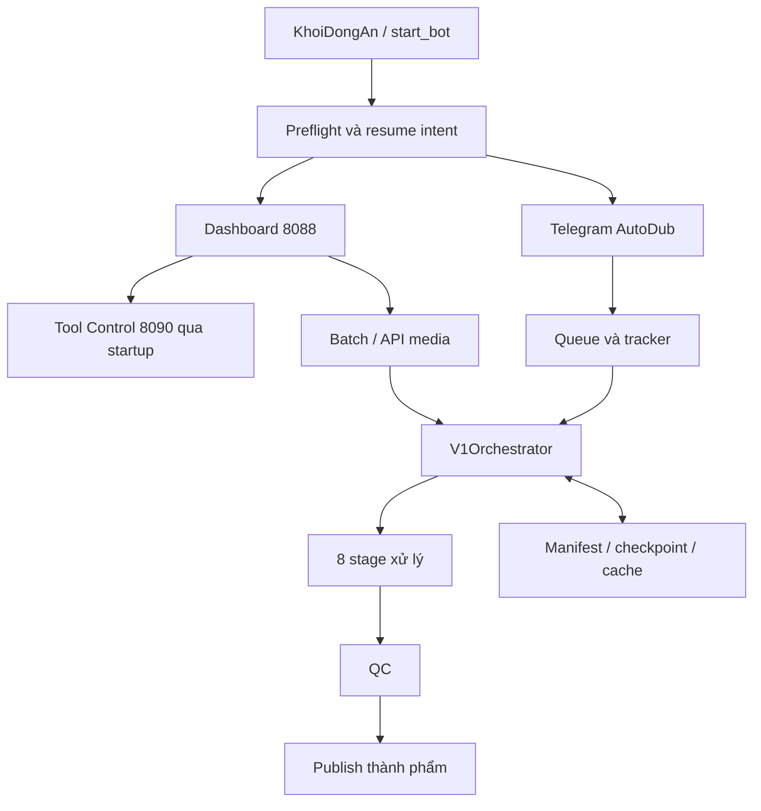

# Review Tool V1 trên laptop — 16/11/2026

Phạm vi: Tool V1 local tại `C:\tool v1`, nhánh `tool-v1`, HEAD `4b2d234`. Cloud được tính riêng và không nằm trong đánh giá này. Review gồm mã nguồn hiện trên đĩa, cấu hình không chứa bí mật, tài liệu, kiểm thử chọn lọc và kiểm tra HTTP chỉ đọc của dịch vụ đang chạy. Không sửa source, restart, gửi Telegram hoặc chạy render/AI provider thật trong lượt review.

**Kết luận:** Tool V1 local đã là một hệ thống xử lý video có đầy đủ pipeline, hàng đợi, phục hồi, dashboard và hai Studio; nền tảng vận hành đang hoạt động. Tuy nhiên chưa nên coi toàn bộ bản hiện tại là một release sạch đã nghiệm thu: còn lỗi OCR/che phụ đề tái hiện được, khác biệt giữa các đường điều khiển tiến trình, thiếu khóa liên tiến trình ở API media trực tiếp và cấu hình ENV chưa nhất quán.

## 1. Trạng thái hiện hành và mức độ chắc chắn

| Hạng mục | Kết quả |
|---|---|
| Runtime chính | `backend/venv`, Python 3.12.14 |
| Runtime dự phòng | Python 3.10.11; chưa chạy suite dự phòng trong review này |
| Dependency chính | `pip check` đạt |
| Preflight | 25/25 đạt, chế độ chỉ đọc |
| Dashboard | `/api/status` hợp lệ; snapshot `idle`, `active=false` |
| Giao diện local | `/`, `/quy-trinh`, `/kich-ban` trả HTTP 200 |
| Tool Control 8090 | TCP đang lắng nghe; chưa có `/health` cấp ứng dụng |
| Workspace thực | `C:\tool v1\workspace` là junction tới `D:\workspace` |
| GPU/RAM lúc kiểm tra | VRAM 1,88/6 GB; RAM 13,35/15,61 GB (~85,5%). Đây là snapshot toàn máy, không phải kết luận memory leak |
| Git | 13 file tracked đang sửa, cùng các file untracked; trạng thái trên đĩa không tương đương commit HEAD sạch |

Health chứng minh dịch vụ đang đáp ứng và môi trường sẵn sàng; không chứng minh mọi nhánh xử lý hay chất lượng mọi video. Không xác minh được mọi module đã được các tiến trình đang chạy nạp lại từ source mới nhất.

## 2. Cấu trúc hệ thống

| Lớp | Thành phần | Vai trò |
|---|---|---|
| Khởi động | `KhoiDongAn.vbs`, `start_bot.bat` | Preflight, resume stop intent, mở Dashboard và Telegram bot |
| Dashboard/API | `backend/main.py` — 8088 | Điều phối HTTP, kiểm soát local, trạng thái, queue, batch và media API |
| Control | `backend/tool_control.py` — 8090 | Bật/tắt, trạng thái tiến trình, lựa chọn giọng |
| Giám sát | `background_service.py`, `ops_watchdog.py` | Supervisor theo service, mutex chống trùng, restart/backoff, quan sát hoặc heal khi được bật |
| Nhập việc | `telegram_bot.py`, `batch_processor.py`, API | Nhận URL/file video, quét thư mục, tạo và nhận job |
| Pipeline local | `v1_orchestrator.py` | Điều phối 8 stage, snapshot cấu hình, resume, QC và publish |
| AI/media | `backend/ai/`, `model_workers/` | ASR, OCR, dịch, TTS, separation, mixing và adapter model |
| Workflow Studio | `workflow_api.py`, `templates/workflow.html`, `static/js/timeline*.js` | Chỉnh sửa theo timeline, SRT/audio/video, export |
| Script Studio | `script_api.py`, `templates/script_studio.html` | Kịch bản, TTS, phân tích video, doodle/whiteboard và render |
| Dịch vụ nghiệp vụ | Các `*_service.py`, `telegram_jobs.py`, `job_tracker.py` | Preset, job config, segment revision, recovery, lịch chạy, notification và thống kê |
| State và artifact | Workspace, JSON manifest/checkpoint/queue, cache | Theo dõi vòng đời job, khóa, snapshot và phục hồi |
| Đóng gói/kiểm thử | `scripts/`, `tests/`, `.github/workflows/` | Health, release manifest, regression và CI |

Inventory source bằng `rg` có **244 file Python trong backend sau khi loại thư mục Cloud**. Có 185 file Python cấp `tests/`, 5 file test JavaScript. Tám module API local có **170 khai báo route**; số này có alias và không phải số endpoint duy nhất đã kiểm tra trực tiếp.

Những file tập trung nhiều trách nhiệm: `workflow_api.py` 5.016 dòng, `main.py` 3.069 dòng, `telegram_bot.py` 2.013 dòng. Dashboard HTML khoảng 527 KiB và Workflow HTML khoảng 493 KiB. Cấu trúc đã có các lớp service, nhưng business logic/media logic còn nằm nhiều trong API và template lớn.

`backend/pipeline_v2/` vẫn cung cấp atomic I/O, lock, validation, QC và tiện ích được V1 dùng. Việc dịch vụ Tool V2 đã retired không có nghĩa package này là mã thừa có thể xóa. Các shim Whiteboard cũng còn vai trò tương thích import.

## 3. Tiến trình và luồng chạy local

Khởi động bình thường có đủ ba thành phần Dashboard, Telegram và Control: Dashboard lifespan gọi `ensure_tool_control()`. Supervisor riêng có smoke import và backoff. Tuy nhiên kiểm tra cổng trong launcher chỉ dùng `netstat/findstr`, và thông báo khởi động thành công chưa phải xác nhận readiness đầy đủ.

Telegram dùng queue trong RAM với snapshot JSON nguyên tử, khôi phục job đang dở/pending, retry mạng và xử lý tuần tự. Telegram/batch giữ lease qua tracker. Các API media trực tiếp có khoảng trống khóa được nêu ở phần phát hiện.

Pipeline chính hiện bật `V1_USE_ORCHESTRATOR=true`; tên `PIPELINE_MODE=legacy` không có nghĩa hệ thống đang bỏ qua orchestrator mới. Đây là lựa chọn runtime V1 so với orchestration V2 đã retired.

| Bước | Xử lý thực tế |
|---|---|
| Chuẩn bị | Nhận/tải nguồn, xác thực media, freeze cấu hình và fingerprint |
| 1. Audio | Trích xuất audio nguồn |
| 2. Separation | BS-RoFormer cho cấu hình video ngắn; Demucs cho video dài |
| 3. ASR | Mặc định hiện tại là hybrid Whisper/SenseVoice |
| 4. OCR | PP-OCRv6, lấy mẫu/track vùng caption, phân biệt nhãn cảnh, sửa ASR có guard |
| 5. Dịch | Gemini và adapter/fallback theo cấu hình; cache, ngữ cảnh, caption evidence và kiểm tra đủ câu |
| 6. TTS/timing | Giọng đã chọn/khóa theo job, đa worker, cache theo cue, fit thời lượng và chặn thiếu audio |
| 7. Mixing | Ghép giọng và nhạc nền, ducking, chuẩn hóa âm lượng |
| 8. Render | ASS/phụ đề/vùng che, FFmpeg và NVENC theo khả năng |
| Hoàn tất | QC, publish nguyên tử, manifest completed, giao output và dọn intermediates |

Cấu hình lưu trên laptop lúc đọc: ASR `whisper_sensevoice`, video mode `AUTO`, short separator `roformer`, long separator `demucs`, TTS 6 workers, tốc độ tự nhiên tối đa 1,50×, QC `BLOCK`, visual-sub-to-speech tắt. Cờ pixel-QC chưa có trong file đã lưu; source hiện hành cung cấp mặc định `true`, không thể từ đó kết luận tiến trình cũ đã nạp mặc định mới.

Ngưỡng router mặc định trong source: SHORT đến 420 giây, LONG trên 420 giây, tối đa 60 phút; nguồn nặng có thể được nâng profile. Smart-skip được bật toàn cục nhưng policy video ngắn có thể ép full OCR. Vì thế không nên mô tả mọi video đều chạy cùng model/lấy mẫu.

## 4. Tính năng hiện có

“Có” dưới đây nghĩa là có implementation và wiring/route trong source; không phải tất cả đã được nghiệm thu video thực trong lượt này.

| Nhóm | Tính năng |
|---|---|
| AutoDub | URL/file video, tải nguồn mạng xã hội, batch thư mục, dịch/lồng tiếng/render xuyên suốt |
| Queue và phục hồi | Queue reorder/delete, pause/resume/stop, retry, khôi phục job dở, checkpoint từng stage, cache translation/TTS |
| Dashboard | Tiến độ, log/trạng thái, input/output, xem media, thống kê tài nguyên, lịch đêm, notification và history |
| Chọn giọng | CapCut/Vie-TTS/Edge theo provider sẵn có; preview; auto voice/dual voice; voice lock và cảnh báo cần review |
| Dịch và phát âm | Adapter Gemini/OpenAI/DeepSeek và lựa chọn model theo cấu hình; glossary, thuật ngữ, caption evidence, guard chữ Hán/câu rỗng |
| Phụ đề | ASR SRT, OCR phụ đề nguồn, sửa/giữ ASR có điều kiện, che phụ đề cũ, ASS, export/import và sửa SRT |
| Workflow Studio | Canvas/background, crop/framing hàng loạt, thumbnail, timeline, speed/freeze/transition, text/logo/music, autosave, undo liên quan, waveform |
| Xử lý thủ công | ASR → dịch → TTS từng bước, tách vocal, proxy preview, phát hiện khoảng lặng, render async/cancel, custom export, Concat integration |
| Segment editor | Xem/sửa từng câu, tạo lại nội dung/audio, nghe original/dub, publish revision |
| Script Studio | Phân tích video, hook/kịch bản, chat AI, preview TTS, render/burn, auto pipeline, doodle/whiteboard/Remotion và preview frame |
| Handoff | Nhận bản dịch SubExtract, render/status/cancel theo hợp đồng handoff |
| Vận hành | Preflight, health, scoped shutdown CLI, process supervision, disk/resource guard, release manifest SHA256 |
| Tiện ích cùng máy | Bot downloader độc lập; không nên bị nút tắt AutoDub dừng nhầm |

Các chức năng generator/model/provider phụ thuộc môi trường, credential và dependency tùy chọn. Route tồn tại không bảo đảm provider đang sẵn sàng. Auto dual voice hiện vẫn có heuristic; cờ cần review không tự dừng pipeline, nên chưa phải nhận diện người nói chắc chắn.

## 5. Phát hiện cần xử lý

### P1 — Geometry chưa xác minh có thể bị biến thành “located”

[v1_ocr_geometry.py:173](<C:/tool v1/backend/v1_ocr_geometry.py:173>) suy vùng che bằng median của các cue khác, gán tọa độ X 0,25–0,75 và đổi trạng thái thành `located` trước khi kiểm tra strict. Khi đạt điều kiện số cue, một cue unresolved có thể đi qua chốt fail-closed mà không có observation riêng. Test `test_report_saved_before_unresolved_error` tái hiện việc không ném `OCRGeometryError`.

Tác động: vùng che suy đoán có thể được coi là đã xác minh; QC tọa độ hợp lệ không đủ chứng minh che đúng chữ nguồn. Nên giữ nguồn gốc/độ tin cậy của geometry và không nâng suy đoán thành verified.

### P1 — Nút Tắt trên Control chưa dùng shutdown an toàn chung

[tool_control.py:219](<C:/tool v1/backend/tool_control.py:219>) chọn process Python/FFmpeg bằng substring đường dẫn, rồi terminate/kill. [Đường gọi off/off_all](<C:/tool v1/backend/tool_control.py:302>) vẫn dùng hàm này, trong khi CLI đã có `v1_shutdown` xác minh identity và scope. Có gửi stop-batch trước, nhưng không chờ xác nhận job đã dừng trước khi terminate.

Repro với nguyên hàm được tách AST và psutil giả xác nhận command của `telebot_video_downloader.py` bị chọn làm mục tiêu. Process khác dùng video nằm trong repo cũng có thể khớp substring. Chưa thực thi nút Tắt hoặc kill process thật. Nên hợp nhất Control với cơ chế shutdown theo scope, bảo vệ downloader và xác minh kết quả thay vì luôn báo đã giải phóng toàn bộ RAM/VRAM.

### P1 — API media trực tiếp chưa giữ lease liên tiến trình

[main.py:598](<C:/tool v1/backend/main.py:598>) kiểm tra tracker rồi lấy `asyncio.Lock` trong process. Ba API `process-video`, `process-url`, `generate-subtitles` không dùng lease của tracker hay decorator [guarded_media_api](<C:/tool v1/backend/api_pipeline_guard.py:12>) đã có sẵn. Telegram lại claim tracker khi bắt đầu job.

Tác động có điều kiện: nếu nhận việc từ API và Telegram/batch gần nhau, API chưa đánh dấu lease chung nên pipeline khác có thể bắt đầu; khóa GPU theo stage không bảo vệ toàn bộ job/artifact. Đây là khoảng trống xác minh bằng code/AST, chưa chạy hai video đồng thời để tái hiện tác động thực tế. Nên có một điểm admission/lease dùng chung cho các entrypoint.

### P1 — Dashboard ghi đè ENV, gây lệch workspace và cô lập test

[main.py:34](<C:/tool v1/backend/main.py:34>) đọc `.env` bằng `os.environ[k] = v`; [environment.py](<C:/tool v1/backend/environment.py:10>) lại quy định process ENV ưu tiên qua `setdefault`. `AppPaths` đọc sau đoạn ghi đè này.

Bằng chứng trong lượt review: bộ test chạy chung có ba test shutdown lỗi do đọc telemetry PID ngoài fixture; cả ba đạt khi chạy riêng. Test path-hardening import `main`, trong khi conftest đã đặt workspace tạm trước đó. Kết quả này phù hợp trực tiếp với việc import main ghi đè workspace. Không nên xem ba lỗi đó là ba lỗi độc lập của thuật toán shutdown; đây là vấn đề ENV/test isolation. Cần bỏ loader riêng và dùng một quy tắc cấu hình thống nhất.

### P2 — Che phụ đề và nhận diện caption còn bốn regression tái hiện được

| Trường hợp | Kết quả tái hiện |
|---|---|
| Khoảng đã xác minh không có chữ | Sinh thêm cover 0–0,4; 1–1,8; 2,2–3 giây ngoài hai khoảng có observation |
| Tracking xác minh rỗng | Vẫn sinh cover từ best_block cũ cho toàn cue 0–3 giây |
| Nhãn lặp không khớp lời thoại | Cue 2/3 bị đưa vào selection dù kỳ vọng chỉ cue 1/4 |
| Caption dịch chuyển theo thời gian | Chỉ giữ 1 trong 2 observation hợp lệ |

Vị trí liên quan: [ass_utils.py:904](<C:/tool v1/backend/ass_utils.py:904>), [ocr_subtitle_locator.py:795](<C:/tool v1/backend/ocr_subtitle_locator.py:795>). Tách nền hiển thị bản dịch khỏi vùng che chữ nguồn để tránh yêu cầu nền kéo dài vô tình mở rộng source mask. Bộ lọc tâm X và rescue cần giữ dữ liệu theo thời điểm, không truyền độ tin cậy qua nhãn lặp.

Pixel-QC hiện lấy ít khung mẫu và chỉ trả PASS/WARN/UNKNOWN ([v1_quality_gate.py:155](<C:/tool v1/backend/v1_quality_gate.py:155>)); nó không bảo đảm phát hiện/chặn toàn bộ lỗi che chữ trên cả video.

### P2 — Async GPU gate bắt nhầm timeout của tác vụ

[v1_gpu_gatekeeper.py:225](<C:/tool v1/backend/v1_gpu_gatekeeper.py:225>) đặt `except TimeoutError` bao cả `yield`. Timeout phát sinh bên trong stage bị hiểu như timeout chờ khóa; context manager tiếp tục yield lần hai. Repro AST/mocks cho `RuntimeError: generator didn't stop after athrow()` thay lỗi gốc. Cần tách lỗi acquisition khỏi lỗi body. Acquisition đồng bộ tối đa 1,5 giây mỗi nhịp cũng có thể chặn event loop ngắn.

### P2 — Health có thể xanh khi mất router

[main.py:2925](<C:/tool v1/backend/main.py:2925>) bắt lỗi import router rồi chỉ log warning; `/api/status` không tổng hợp trạng thái router. [Health probe](<C:/tool v1/scripts/verify_runtime_health.py:85>) chỉ kiểm tra `status` và `active`. Vì vậy workflow/script API có thể mất mà dashboard health vẫn đạt. Lượt kiểm tra trực tiếp hiện tại cả hai trang Studio đều HTTP 200: đây là lỗ hổng quan sát/phục hồi, không phải tuyên bố trang đang hỏng.

### P2/P3 — Nợ cấu trúc, cấu hình và tài liệu

- Đường dẫn tuyệt đối `C:\tool v1` còn rải rác trong control/model registry và media helpers, dù đã có `AppPaths`; checkout khác có thể chạm nhầm dữ liệu production.
- API, business logic và media execution còn gộp trong các file 2.000–5.000 dòng; HTML/CSS/JS lớn làm regression và review khó.
- README còn mô tả ASR Whisper đơn thuần và giới hạn 1,45×, trong khi source/cấu hình hiện tại là hybrid và 1,50×.
- `tests/conftest.py` có 74 nodeid quarantine, bao gồm nhiều vùng safety/QC/resource/translation. Phải triage từng hợp đồng; không xóa kỳ vọng chỉ để có số pass đẹp.
- Manifest/checkpoint và snapshot tốt cho phục hồi, nhưng thay source không tự cập nhật job cũ đã cache. Cần revision/reprocess có kiểm soát.

## 6. Kiểm chứng trong lượt review

| Bộ kiểm tra | Kết quả |
|---|---|
| 8 file OCR/ASS/tracking/ASR correction/caption evidence/dual voice/pixel QC | **125 passed, 5 failed, 1 skipped** |
| 12 file checkpoint/QC/path/Studio safety/stop/shutdown/recovery/release/health | **124 passed, 3 failed** |
| Chạy riêng ba test shutdown vừa lỗi | **3 passed**; không thay test/source |
| JavaScript `tests/js/*.test.js` | **13 passed, 0 failed** |
| Health runtime ngoài giới hạn socket sandbox | **5/5 probe đạt**, trong đó preflight **25/25** |
| HTTP local | Bốn URL `/`, `/quy-trinh`, `/kich-ban`, `/api/status`: **200** |

Năm lỗi OCR/ASS đúng với các vấn đề đã ghi ở bàn giao 14/11; được chạy lại và xác nhận trong review này. Ba lỗi shutdown khi chạy chung được phân biệt với lỗi xử lý media ở trên. Một lượt kiểm thử trong sandbox bị dừng vì phần async không tiến triển; không tính lượt dở đó là pass. Lượt chạy hoàn tất ngoài giới hạn socket có kết quả được ghi trong bảng.

Chưa chạy toàn bộ 185 file test, suite Python 3.10, benchmark nhiều video, hoặc nghiệm thu TTS/render mới. Mốc 1.255 passed trong PROJECT_STATE là kết quả lịch sử 02/11, không thay thế kết quả hiện tại.

## 7. Tiến độ chức năng và việc còn thiếu

| Mức | Đánh giá local |
|---|---|
| Đã có nền tảng | Startup, service, Telegram, batch, pipeline 8 bước, model isolation, checkpoints, atomic output, dashboard/Studio |
| Đã có nhiều cải tiến | Hybrid ASR, OCR geometry/tracking, caption evidence, translation guard, voice lock/review, timeline/manual flow, QC và recovery |
| Đang có sửa đổi trên đĩa | OCR, ASR correction, translation metadata, dual voice, ASS và một số wiring; chưa phải một release sạch theo HEAD |
| Còn lỗi tái hiện | 5 lỗi OCR/ASS, ENV/test isolation, cùng các khoảng trống vận hành/khóa được nêu trên |
| Còn nghiệm thu thành phẩm | 16 câu dịch trong hồ sơ 16/11 mới có SRT đã rà; audio/video cũ chưa đại diện cho nội dung mới |
| Yêu cầu mới đã đưa vào kế hoạch | Thay hộp trắng che phụ đề nguồn bằng làm mờ cục bộ video; hoàn thiện nhánh blur sẵn có và chuyển mặc định sau nghiệm thu (mục 9) |

[Báo cáo ASR/dịch 16/11](<C:/tool v1/docs/ASR_TRANSLATION_REVIEW_20261116.md>) ghi 77 cue đã rà và 16 chỉnh sửa dịch; cần tạo lại TTS, fit timing, ASS/render và QC đúng revision trước khi chốt chất lượng. Test offline đạt không thay cho nghe/xem đầu ra mới.

## 8. Thứ tự công việc đề xuất

1. **Chốt vận hành local:** hợp nhất shutdown Control/CLI, sửa ENV precedence, dùng lease chung cho API/Telegram/batch, sửa GPU timeout handling.
2. **Chốt tọa độ và thời gian phụ đề nguồn:** xử lý năm regression đang đỏ, phân biệt source mask với nền bản dịch, giữ evidence geometry theo thời điểm. Đây là đầu vào bắt buộc cho vùng làm mờ chính xác.
3. **Thay hộp trắng bằng làm mờ cục bộ:** hoàn thiện `localized_blur`, bỏ hộp nền ASS, nối cấu hình nhất quán giữa Dashboard/Telegram/batch/Studio và kiểm tra trên video mẫu theo mục 9; sau nghiệm thu chuyển mặc định cho job mới.
4. **Nghiệm thu output mới:** tạo lại TTS/render cho các cue đã sửa, kết hợp kiểm tra kiểu blur mới; chạy mẫu local có caption di chuyển, caption mất theo đoạn, nhãn sản phẩm, lời ngắn và dual voice; lưu source/revision/output/QC tương ứng.
5. **Lập baseline release local:** chạy suite đầy đủ trên runtime chính, phân loại quarantine và lỗi còn mở, cập nhật tài liệu theo cấu hình thực, commit/release sau khi đủ evidence.
6. **Refactor từng ranh giới:** tách media job service khỏi main/workflow API, tách UI assets, đưa đường dẫn về AppPaths và thêm component-health cho router. Không cần viết lại toàn bộ hệ thống.

Đánh giá này đề xuất thứ tự khắc phục; không áp dụng các thay đổi hoặc tác động dịch vụ trong lượt review.

## 9. Hạng mục bổ sung: thay hộp trắng bằng làm mờ video cục bộ

**Yêu cầu người dùng ngày 16/11/2026:** vùng che phụ đề gốc chuyển sang phần video được làm mờ. Phạm vi chỉ Tool V1 trên laptop. Trạng thái của lượt này: đã cập nhật kế hoạch, chưa thay cấu hình chạy hoặc triển khai source.

### Kết quả hiển thị cần đạt

- Làm mờ pixel video trong vùng phụ đề nguồn, bám đúng vị trí và khoảng thời gian chữ xuất hiện; có padding vừa đủ để phủ nét chữ và viền.
- Bỏ hộp trắng và hộp nền tối trong chế độ mới. Phụ đề Việt vẽ sau bước blur, dùng viền/bóng nhẹ để dễ đọc trên nền sáng và tối.
- Không làm mờ toàn video hoặc mặc định kéo một băng ngang rộng. Khoảng đã xác minh không có caption phải trở về hình ảnh bình thường.
- Vùng blur theo thời gian caption nguồn, độc lập với thời lượng TTS hoặc nền hiển thị câu dịch. Không lấy việc kéo dài câu dịch làm lý do kéo dài vùng blur.
- Mặc định dự kiến cho job mới là `localized_blur` sau nghiệm thu. Chế độ hộp cũ chỉ giữ cho tương thích/rollback rõ ràng, không tự fallback trong một job đã chọn blur.

### Tận dụng phần đã có và khép khoảng trống

Source hiện đã có lựa chọn blur ở [Dashboard](<C:/tool v1/backend/templates/dashboard.html:2264>), nhưng [canvas_settings.py](<C:/tool v1/backend/canvas_settings.py:64>) vẫn mặc định `solid_box`. Orchestrator truyền vùng OCR sang renderer; [video_utils.py](<C:/tool v1/backend/video_utils.py:715>) có crop → boxblur → overlay → burn phụ đề. Đây là nền để hoàn thiện, chưa phải bằng chứng thành phẩm đã đạt yêu cầu mới.

| Việc | Phần cần làm | Điều kiện hoàn thành |
|---|---|---|
| Tách nền khỏi chữ | Sửa ASS để chế độ blur chỉ sinh chữ/outline/shadow, không sinh hộp trắng hay nền tối bán trong suốt hiện có | Frame xuất thực không còn hình chữ nhật tô màu dưới phụ đề |
| Giữ geometry theo thời gian | Dùng observation đã xác minh và khoảng hiện caption nguồn; sửa các lỗi geometry ở mục 5 | Caption di chuyển được bám đúng; tracking rỗng không hồi sinh best_block |
| Không gộp blur qua khoảng trống | Rà việc gộp gap ≤0,35 giây, ép tối đa 4 cụm vùng và 18 khoảng trong renderer | Tối ưu filtergraph không làm mờ thêm vùng/thời gian đã xác minh không có chữ |
| Xử lý thiếu tọa độ | Bỏ fallback âm thầm làm mờ băng rộng suốt video; giữ trạng thái chưa xác minh và cho sửa/review vùng khi cần | Không đánh dấu job đạt chỉ vì có một vùng blur suy đoán |
| Render đúng thứ tự | Blur trên video nguồn trước khi vẽ phụ đề Việt; giữ mapping crop/scale/pad/timeline; ép `format=yuv420p` ở nhánh crop/blur | Chữ Việt không bị blur; bbox đúng trên output dọc/ngang và sau chỉnh khung |
| Cấu hình thống nhất | Một lựa chọn “Làm mờ vùng phụ đề gốc”, mức mờ/padding có giới hạn và preview; freeze style/tham số vào job | Dashboard, Telegram, batch, API và Studio dùng cùng cấu hình của job; resume không tự đổi kiểu |
| Cache và render lại | Đưa style, tham số blur, phiên bản geometry vào khóa cache ASS/render | Đổi kiểu che buộc tạo lại ASS/video; vẫn tái sử dụng ASR/dịch/TTS nếu nội dung và timing không đổi |

Chế độ `frosted_blur` làm mờ cả băng ngang không phải mặc định của hạng mục này. Nhánh `localized_blur` hiện vẫn sinh nền tối tại [ass_utils.py](<C:/tool v1/backend/ass_utils.py:534>), nên chỉ đổi giá trị cài đặt chưa đáp ứng đầy đủ yêu cầu “chỉ làm mờ video”.

### Nghiệm thu trước khi chuyển mặc định

1. Kiểm thử geometry và filtergraph: không nối qua khoảng vắng chữ, không nhận nhãn sản phẩm làm caption, không fallback vùng rộng khi thiếu boxes, không vượt biên ảnh, không lấy timing TTS thay timing nguồn.
2. Render và xem A/B trên mẫu dọc/ngang, chữ sát mép, hai dòng, chữ di chuyển, caption biến mất rồi xuất hiện lại, nền sáng/tối và video không có caption.
3. Xác nhận chữ nguồn đã được làm mờ đủ để không còn đọc rõ ở tốc độ phát bình thường, chữ Việt dễ đọc, không còn hộp tô màu và không bị mờ các chi tiết ngoài vùng đã chọn. OCR tự động chỉ là kiểm tra hỗ trợ, không thay cho xem thành phẩm.
4. Kiểm tra kích thước, fps, thời lượng, đồng bộ audio và timing phụ đề; đo thời gian render/RAM/VRAM so với cùng video dùng hộp cũ. Chốt mức blur theo chất lượng và chi phí thực đo, không mặc định coi blur miễn phí về hiệu năng.
5. Thử cùng cấu hình qua Telegram/batch và render lại từ Studio; kiểm tra resume/checkpoint giữ đúng style, tham số và geometry.
6. Sau khi đạt, chuyển mặc định cho job mới. Video cũ cần tạo revision/render lại từ video nguồn cùng artifact phù hợp; không blur lên file thành phẩm đã nướng hộp trắng. Job đang chạy hoặc checkpoint cũ giữ snapshot đến khi được reprocess rõ ràng.

Hạng mục này nằm ngay sau sửa geometry và trước nghiệm thu thành phẩm/release local. Việc đổi hình thức che không thay thế việc sửa năm regression OCR/ASS hiện còn mở.
