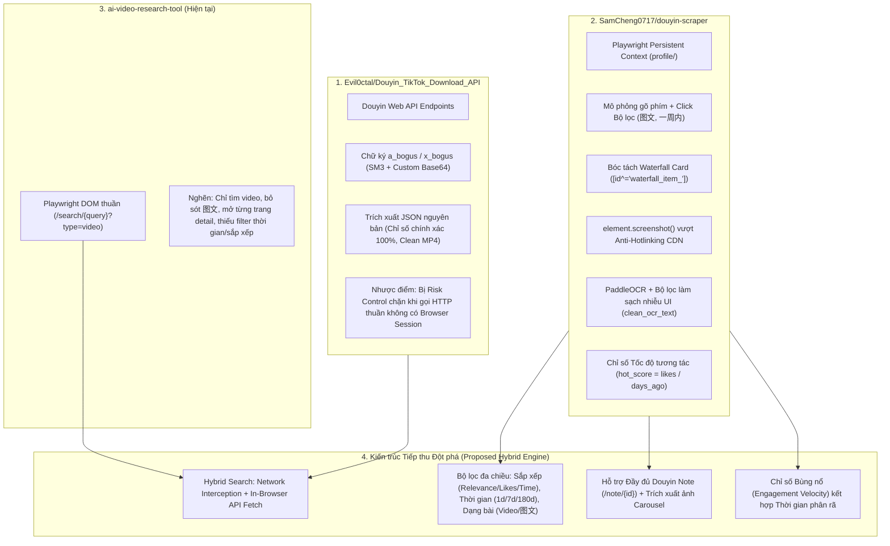

# Báo cáo Nghiên cứu Chuyên sâu: Cơ chế Tìm kiếm Douyin theo Từ khóa & Kế hoạch Tiếp thu Công nghệ

> **Dự án đối sánh:**
> 1. `Evil0ctal/Douyin_TikTok_Download_API` (v4 & v5) — *Direct API Reverse Engineering & Signature Generation*
> 2. `SamCheng0717/douyin-scraper` — *Browser-Driven Automation, Anti-Scraping Bypass, Carousel (图文) & Velocity Scoring*
> 3. `ai-video-research-tool` (Dự án hiện tại) — *Playwright + Anti-detection + CJK Intent + Virality Analysis*

---

## 1. Tổng quan Nghiên cứu

Mục tiêu nghiên cứu: Phân tích toàn diện mã nguồn mở liên quan đến khả năng **tìm kiếm Douyin theo từ khóa (Keyword Search)**, giải mã cơ chế hoạt động, tham số truy vấn, chữ ký mã hóa bảo mật, kỹ thuật vượt rào cản anti-scraping và trích xuất dữ liệu đa phương tiện (video & ghi chú hình ảnh - 图文). Từ đó, xây dựng kiến trúc nâng cấp toàn diện cho công cụ nghiên cứu video của hệ thống.



---

## 2. Giải mã Chi tiết 2 Mã Nguồn Mở

### 2.1. `Evil0ctal/Douyin_TikTok_Download_API`: Khai thác Tầng API & Chữ ký `a_bogus`

#### A. Các Endpoint Tìm kiếm Cốt lõi của Douyin Web
Qua phân tích tệp `crawlers/douyin/web/endpoints.py` và kiến trúc v5, các endpoint tìm kiếm chính thức của Douyin bao gồm:

| Endpoint | Đường dẫn URL | Mục đích |
| :--- | :--- | :--- |
| **Video Search** | `https://www.douyin.com/aweme/v1/web/search/item/` | Tìm kiếm chuyên biệt danh sách video theo từ khóa |
| **General Search** | `https://www.douyin.com/aweme/v1/web/general/search/single/` | Tìm kiếm tổng hợp (video, ghi chú hình ảnh, tài khoản, livestream) |
| **Suggest Words** | `https://www.douyin.com/aweme/v1/web/api/suggest_words/` | Gợi ý từ khóa liên quan / xu hướng tìm kiếm khi gõ |
| **Hot Search** | `https://www.douyin.com/aweme/v1/web/hot/search/list/` | Bảng xếp hạng từ khóa nóng (Trending / Hot Board) thời gian thực |

#### B. Cấu trúc Tham số Truy vấn (Query Parameters)
Để gọi thành công API tìm kiếm, Douyin yêu cầu bộ tham số thiết bị và bộ lọc nghiêm ngặt:

```json
{
  "device_platform": "webapp",
  "aid": "6383",
  "channel": "channel_pc_web",
  "search_channel": "aweme_general", // hoặc "aweme_video"
  "keyword": "từ_khóa_url_encoded",
  "sort_type": 0,                    // 0: Tổng hợp, 1: Nhiều like nhất, 2: Mới nhất
  "publish_time": 0,                  // 0: Toàn bộ, 1: 1 ngày, 7: 1 tuần, 180: 6 tháng
  "offset": 0,                        // Vị trí phân trang (0, 15, 30, ...)
  "count": 15,                        // Số lượng kết quả mỗi trang
  "version_code": "290100",
  "version_name": "29.1.0",
  "cookie_enabled": "true",
  "screen_width": 1920,
  "screen_height": 1080,
  "browser_language": "zh-CN",
  "browser_platform": "Win32",
  "browser_name": "Chrome",
  "browser_version": "130.0.0.0",
  "msToken": "chuỗi_msToken_ngẫu_nhiên_hoặc_thực",
  "a_bogus": "chữ_ký_mã_hóa_sinh_ra_từ_toàn_bộ_param_và_ua"
}
```

#### C. Thuật toán Ký `a_bogus` (Pure Python SM3 Implementation)
Trong tệp `crawlers/douyin/web/abogus.py`, Evil0ctal kế thừa thuật toán từ `JoeanAmier/TikTokDownloader`, hiện thực hóa 100% bằng Python thuần:
1. **Băm SM3 (ShangMi 3):** Toàn bộ chuỗi query parameters và User-Agent được đưa qua hàm băm tiêu chuẩn mật mã học Trung Quốc `gmssl.sm3`.
2. **Xáo trộn mảng byte & Canvas/Fingerprint giả lập:** Sử dụng mảng hằng số trình duyệt `__browser = "1536|742|1536|864|0|0|0|0|1536|864|1536|864|1536|742|24|24|MacIntel"` và bảng mã hoá Base64 tuỳ biến (`s1`, `s2`, `s3`, `s4`).
3. **Ưu điểm lớn:** Cho phép sinh chữ ký `a_bogus` ngay trong môi trường Python mà không cần cài đặt Node.js hay gọi `execjs`/JSDOM nặng nề.

#### D. Điểm yếu và Thực tế Vận hành (Reality Check từ JoeanAmier #668)
- Douyin liên tục cập nhật hệ thống WAF và kiểm tra rủi ro (Risk Control). Các yêu cầu gọi HTTP API trực tiếp từ bên ngoài trình duyệt (kể cả có `a_bogus`) rất dễ bị chặn hoặc trả về danh sách rỗng (`[]`) nếu thiếu cookie phiên thực tế (`ttwid`, `sessionid`) và bối cảnh trình duyệt hợp lệ.
- **Bài học rút ra:** Không nên phụ thuộc 100% vào việc gọi HTTP bên ngoài. Thay vào đó, **phải kết hợp phiên trình duyệt Playwright (Hybrid Approach)**: lấy cookie sống hoặc dùng Network Interception trong Playwright để hứng API response.

---

## 2.2. `SamCheng0717/douyin-scraper`: Tự động hoá Trình duyệt, Bóc tách 图文 & Chỉ số Tốc độ

Dự án `douyin-scraper` tập trung giải quyết bài toán cào dữ liệu thực chiến khi các API bị khóa chặn:

#### A. Mô phỏng Hành vi Người dùng để Tìm kiếm & Lọc
Trong `scripts/full_workflow.py`:
- Sử dụng `launch_persistent_context` với profile lưu trữ đăng nhập (`profile/`).
- Bỏ cờ tự động hoá: `--disable-blink-features=AutomationControlled`, xóa `navigator.webdriver`.
- Gõ từ khóa vào ô `input[placeholder*="搜索"]` với độ trễ phím tự nhiên (`delay=100ms`).
- Thao tác trực tiếp trên UI dropdown "筛选" (Bộ lọc) để chọn:
  - Thể loại: **"图文" (Hình ảnh/Ghi chú)**
  - Thời gian: **"一周内" (Trong vòng 1 tuần)**
- Trích xuất danh sách thẻ qua selector `[id^="waterfall_item_"]` thay vì phụ thuộc vào thẻ `a` thông thường.

#### B. Kỹ thuật Chụp ảnh Màn hình Element (`element.screenshot()`) vượt Anti-Hotlinking
- **Vấn đề của Douyin:** Các URL hình ảnh (`p3-pc.douyinpic.com`) thường có chữ ký thời hạn (`Expires`, `Signature`) hoặc kiểm tra Referer gắt gao. Tải bằng HTTP request thông thường thường bị trả về `403 Forbidden`.
- **Giải pháp của SamCheng:** Playwright điều hướng tới trang bài viết `https://www.douyin.com/note/{id}`, định vị thẻ `img[class*="otaLO99b"]` đang hiển thị trên viewport và gọi trực tiếp:
  ```python
  await img_el.screenshot(path=str(save_path))
  ```
  Cách này chụp lại chính xác frame đã được render giải mã trên GPU của trình duyệt, triệt tiêu hoàn toàn khả năng bị chặn hotlink.
- Đối với bài viết nhiều ảnh (Carousel): Phát hiện chỉ số `1/N`, sau đó bấm nút chuyển tiếp hoặc nhấn phím `ArrowRight` để lần lượt chụp toàn bộ ảnh.

#### C. Xử lý OCR & Bộ lọc Làm sạch Nhiễu Giao diện
- Tích hợp PaddleOCR để nhận diện chữ trong ảnh carousel (nơi chứa 80% kiến thức, kịch bản của dạng bài 图文).
- **Bộ lọc nhiễu `clean_ocr_text`:** Loại bỏ các từ ngữ thanh điều hướng hệ thống Douyin lọt vào ảnh:
  `_NAV_NOISE = {"抖音", "精选", "推荐", "搜索", "关注", "朋友", "我的", "直播", "放映厅", "短剧", "小游戏", "AI搜索"}`.

#### D. Chỉ số Tốc độ Tương tác (Engagement Velocity / Hot Score)
- Thay vì chỉ nhìn vào tổng số like tích lũy (vốn chỉ ưu ái các video cũ đã đăng hàng tháng/năm), công cụ tính:
  $$\text{hot\_score} = \frac{\text{likes}}{\max(\text{days\_ago}, 0.1)}$$
  Công thức này ngay lập tức đưa các video/bài viết mới đăng vài giờ nhưng có tốc độ like bùng nổ lên vị trí ưu tiên số 1 để nghiên cứu xu hướng.

---

## 3. Ma trận So sánh Kỹ thuật Đối chuẩn

| Tiêu chí | `Evil0ctal` (API) | `SamCheng` (Scraper) | `ai-video-research-tool` (Hiện tại) | **Giải pháp Tích hợp Tối ưu (Đề xuất)** |
| :--- | :--- | :--- | :--- | :--- |
| **Cơ chế Thu thập** | Gọi HTTP API trực tiếp | Playwright DOM Scraping | Playwright DOM Scraping | **Hybrid:** Network Interception + Playwright Fallback |
| **Tốc độ Tìm kiếm** | Siêu nhanh (< 1s) | Chậm (5-15s / trang) | Trung bình (mở trang chi tiết) | **Siêu nhanh (< 2s):** Bắt ngay JSON network khi trang load |
| **Độ chính xác Số liệu** | Tuyệt đối (Số nguyên) | Tương đối (1.2万) | Tương đối (Parse text) | **Tuyệt đối 100%:** Lấy từ JSON data packet |
| **Khả năng bị Chặn/Ban** | Cao (dễ trả về rỗng) | Rất thấp (dùng browser) | Rất thấp | **Rất thấp:** Duy trì persistent context đã đăng nhập |
| **Bộ lọc Tìm kiếm** | Đầy đủ tham số query | Click UI (图文, 1 tuần) | Không hỗ trợ (chỉ query từ khóa) | **Đầy đủ:** Hỗ trợ Sắp xếp, Thời gian, Dạng bài trên UI & Backend |
| **Hỗ trợ Dạng bài** | Video & Note (JSON) | Chỉ chuyên Note (图文) | Chỉ Video (`/video/`) | **Đầy đủ:** Hỗ trợ cả Video (`/video/`) và Note (`/note/`) |
| **Trích xuất Hình ảnh** | URL gốc (có thể expire) | `element.screenshot()` | Chỉ lấy cover thumbnail | **Đa tầng:** Tải URL gốc có cookie; fallback chụp element |
| **Phân tích Nội dung** | Hashtags, Title, Desc | OCR chữ trên ảnh | Hashtags, Audio Transcript | **Toàn diện:** OCR ảnh + Audio Transcript + Metadata |
| **Xếp hạng Xu hướng** | Không có | `hot_score = likes/days` | Virality Score tĩnh | **Dynamic Velocity Score** (Likes, Comments, Shares / Giờ) |

---

## 4. Năm Trụ Cột Đột Phá Tiếp Thu Cho Hệ Thống

### Trụ cột 1: Công cụ Tìm kiếm Hybrid (Network Interception + In-Browser API Fetch)
- Khi `DouyinBrowserService` mở trang tìm kiếm `https://www.douyin.com/search/{query}?type=general`, trình duyệt Douyin luôn tự động gửi request đến `aweme/v1/web/general/search/single/` hoặc `aweme/v1/web/search/item/`.
- **Cơ chế Interception:** Ta cài đặt lắng nghe mạng `page.on('response', ...)` trong Playwright. Ngay khi Douyin trả về JSON tìm kiếm:
  - Hệ thống lập tức bóc tách danh sách `aweme_list`.
  - Thu được toàn bộ số liệu chính xác: `digg_count`, `comment_count`, `share_count`, `collect_count`, `create_time`, `aweme_id`, link video không logo (`play_addr.url_list`).
  - **Không cần mở thêm bất kỳ tab chi tiết nào (`detail.goto`)**, giảm thời gian tìm kiếm từ 30 giây xuống dưới 3 giây!
- **Cơ chế Fallback:** Nếu Douyin thay đổi endpoint API mạng, hệ thống tự động fallback về bộ bóc tách DOM nâng cao dựa trên selector `[id^="waterfall_item_"]` của SamCheng.

### Trụ cột 2: Mở rộng Bộ lọc Tìm kiếm Đa chiều (Search Filters)
Mở rộng contract schema trong `backend/schemas/contracts.py`:
- `sort_by`:
  - `relevance` (Mặc định: 0)
  - `most_liked` (Nhiều like nhất: 1)
  - `newest` (Mới nhất: 2)
- `publish_time`:
  - `all` (Toàn bộ thời gian: 0)
  - `day` (Trong 1 ngày qua: 1)
  - `week` (Trong 1 tuần qua: 7)
  - `six_months` (Trong nửa năm qua: 180)
- `content_type`:
  - `all` (Tất cả: Video + 图文)
  - `video` (Chỉ video)
  - `image_text` (Chỉ ghi chú hình ảnh - 图文)

Các bộ lọc này được chuyển đổi thành tham số query trên URL hoặc click tự động trên giao diện bộ lọc của Douyin.

### Trụ cột 3: Hỗ trợ Đầy đủ Ghi chú Hình ảnh Douyin (图文 Carousel)
- Bổ sung nhận diện URL dạng `https://www.douyin.com/note/{note_id}` song song với `video/{video_id}`.
- Bổ sung trường `media_type`: `"video" | "image_text"` trong `VideoResult`.
- Tích hợp cơ chế tải ảnh an toàn:
  1. Thử tải trực tiếp bằng session cookie và header Referer của trình duyệt.
  2. Nếu bị chặn (403), kích hoạt kỹ thuật chụp màn hình phần tử `element.screenshot()` từ `douyin-scraper`.

### Trụ cột 4: Công thức Tính Điểm Tốc độ Lan truyền (Engagement Velocity Score)
Tích hợp yếu tố thời gian phân rã (Time Decay) vào hệ thống chấm điểm virality:
$$\text{velocity\_score} = \frac{\text{likes} + 2 \times \text{comments} + 3 \times \text{shares} + 2 \times \text{collects}}{\max(\text{hours\_since\_published}, 1)^{0.8}}$$
Giúp người dùng phát hiện những chủ đề/video đang "viral nóng hổi" trong 24h - 48h qua để đón đầu xu hướng làm video phôi.

### Trụ cột 5: Đồng bộ Cookie Tự động Giữa Browser & Local Downloader Adapter
- Trích xuất cookie sống từ `DouyinBrowserService` (`data/browser/douyin/auth_state.json`) và tự động truyền sang `DouyinDownloadAdapter` (port 5555) và các request API ngầm.
- Giúp lượt tìm kiếm và lượt tải video chất lượng cao (1080p / 4K không logo) luôn có cookie xác thực, tránh hoàn toàn rủi ro bị khóa IP hay Captcha.

---

## 5. Kết luận
Hai mã nguồn mở `Evil0ctal` và `SamCheng` bổ sung hoàn hảo cho nhau: một bên mang lại hiểu biết sâu sắc về cấu trúc API nội bộ và dữ liệu chuẩn của Douyin, một bên cung cấp giải pháp thực chiến vượt qua cơ chế phòng thủ web bằng Playwright. Việc tích hợp mô hình **Hybrid Search** kết hợp bộ lọc thời gian và xử lý bài viết hình ảnh (图文) nâng cấp công cụ nghiên cứu video của hệ thống lên chuẩn công nghiệp cao nhất.
